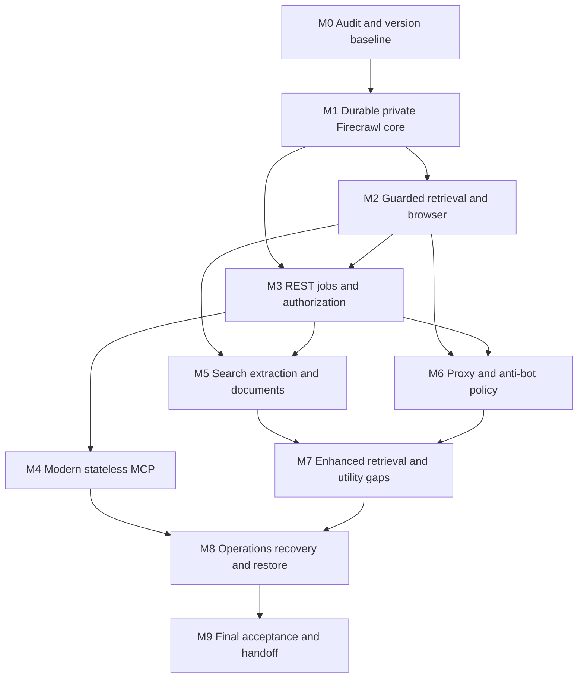

# Firecrawl Pi Platform — Milestones and Acceptance Plan

**Canonical document:** `FIRECRAWL_PI_MILESTONES.md`  
**Architecture authority:** `FIRECRAWL_PI_SPEC.md`, version 1.0, 2026-09-22  
**Target:** Raspberry Pi 5, ARM64, 8 GB RAM  
**Current state:** recorded only in the status and blocker register at the end of this document.

## Execution contract

Read the companion specification and the repository's applicable `AGENTS.md`/`CLAUDE.md` before implementation. The spec governs architecture and source interpretation; this document governs scope, dependencies, acceptance, and recovery. There are **exactly two canonical documents**. Implementation manifests, tests, scripts, and dated evidence reports are permitted operational artifacts, not new specifications.

All paths below are proposed implementation paths relative to `/opt/firecrawl-pi` unless stated otherwise. Do not claim those paths currently exist on the Pi. Discover actual host/storage/network facts in M0. Preserve unrelated services, data, firewall rules, and working client configurations. No step authorizes purchases, public exposure, reimaging, destructive disk operations, or broad cleanup outside the project.

### Autonomy and review

Once an implementation session is authorized, routine project-scoped package/runtime installation, image builds, directory creation, configuration, service restarts, scripts, networking changes within the approved boundary, tests, resource tuning, and failure recovery should proceed without repeated human approval. Respect the host/agent's actual permission controls. Missing credentials block only their live tests, not independent implementation or fixture verification.

After each milestone's implementation, run `/review-2`, then `/address` after the review report, where those repository commands exist. Rerun affected tests before acceptance. If the chosen agent lacks those commands, perform equivalent independent review/remediation and record the substitution honestly. Do not describe a review as independent if it was merely the same execution log reread without a separate critical pass.

Human verification must be **None** unless it needs an unavailable physical observation, account consent/login, a credential, or an actual budget/purchase/exposure decision. Do not ask the user to run shell/API checks the agent can automate. Record unavoidable inputs once in the blocker register, continue independent work, and avoid repeated approval loops.

### Status and evidence discipline

Use milestone states `NOT_STARTED`, `IN_PROGRESS`, `IMPLEMENTED_PENDING_LIVE`, `BLOCKED`, and `ACCEPTED`. Record individual tests as `PASS`, `FAIL`, `NOT_RUN`, or `BLOCKED_CREDENTIAL`. An optional disabled feature is `NOT_ENABLED`/`NOT_REQUIRED`, not an implied pass. The spec's capability states distinguish designed, locally verified, and live-verified behavior.

A dependency can permit implementation to proceed when its explicitly listed **implementation gate** has passed, even if an unrelated live credential test is pending. That does not make the earlier milestone accepted. M9 full acceptance requires every mandatory criterion, including real proxy, enhanced, model, and complex-parser calls, to pass.

For every verification retain: command/test ID, timestamp in UTC, source and patch hashes, image digests/platform, configuration/fixture hashes, expected/actual outcome, exit code, resource/cost measurements where relevant, and redacted evidence path. Keep concise milestone status/evidence links here; keep full machine reports under `evidence/`. Never mark “looks good” as acceptance.

## Baseline to preserve

| Item | Contract |
|---|---|
| Firecrawl | `v2.11.162`, source `7666c1f9ae8720a6bba271e0f60b6a217f8a5210`; guide-pinned API-image snapshot, distinct from observed formal Release `v2.11.0` |
| MCP | Stable `2026-07-28`, modern stateless Streamable HTTP `/mcp` |
| SDK | Official TypeScript v2; verified `@modelcontextprotocol/server@2.1.0`, compatible packages frozen in lockfile |
| Legacy interoperability | SDK-provided stateless `2025-11-25` support, not a custom session store |
| Core | Curated Compose; PostgreSQL 17/NuQ + Redis + RabbitMQ; no FoundationDB server/init |
| Retrieval | Small pinned engine integration; local bounded browser; per-request egress/budget/quality policy |
| Providers | Decodo raw proxy, Zyte enhanced, remote approved model, LlamaParse complex parser; alternatives explicitly gated |
| Limits | One NuQ worker, one browser page, at most two URL acquisitions; total proposed container memory caps 6,432 MiB subject to measured host fit |
| Spending | Paid dispatch disabled; zero paid caps until owner-approved policy |
| Access | Private authenticated gateway; optional account-gated OpenAI tunnel; no public unauthenticated API/MCP |

These baseline facts and supporting primary sources are recorded in spec §§3, 10–19, and 38. Recheck security-maintained releases and immutable ARM64 artifacts, but do not silently substitute a new architecture or draft protocol.

## Dependency map

M5/M6 live credential gates may remain pending while other implementations proceed. M8 can begin local recovery/fixture work once the relevant implementation gates are stable. No mandatory external-provider failure is waived at M9.

---

## M0 — Read-only environment audit and frozen implementation baseline

### Objective

Establish whether the actual Pi can host the selected architecture safely, and freeze a reproducible, security-reviewed build plan before changing it.

### Dependencies

Both canonical documents and access to the intended Pi. No assumption about its OS, boot medium, installed software, or existing workloads.

### Scope

Read-only host/network/storage inspection; official source/SDK review; compatible image manifests and native dependency assessment; resource fit; location of required operational configuration; missing credential/account inventory.

### Out of Scope

Installing packages, starting containers, reimaging, modifying firewall/storage/services, entering paid credentials into unreviewed software, and beginning a public ingress setup.

### Implementation Work

Collect the complete inventory in spec §4, including cgroups, actual RAM and existing service consumption, data mounts/free space/inodes, Docker/Compose, ports, Tailscale, firewall backend, thermals, cooling/power indications, and device identity. Use existing commands only during the read-only audit; record unavailable probes instead of installing utilities as part of it.

Verify the Firecrawl tag→commit and selected official SDK version, current security notes, PostgreSQL/NuQ schema initialization, the API harness's actual worker variable/process count, and native dependency paths. Inspect ARM64 manifests or plan a native ARM64 build; do not treat a published multi-arch base image as proof that the complete stack works. Record resolved image digests and unresolved build requirements without inventing values.

Select project paths and storage mount identity that preserve current services. Validate the 6,432 MiB proposed cap envelope against real available resources, not marketed RAM. Identify any concrete host blocker and the least disruptive remediation. Update both canonical documents only if evidence requires an architecture change.

### Artifacts

`evidence/M0/audit.json`, a short redacted audit interpretation, `deploy/versions.lock.json` with verified entries and explicit unresolved fields, storage/network plan, and a single credential/blocker register in this document. These artifacts may be authored in the implementation workspace without modifying the Pi's service state.

### Automated Verification

Validate audit completeness/schema, exact machine identity and ARM64 userspace, mount/free-space/resource calculations, duplicate/occupied port detection, source SHA resolution, digest/platform consistency, and secret redaction. Compare before/after service/container/port inventory to prove no operational change during M0.

### Human Verification

Only actual missing access, account consent, or an unobservable physical power/cooling/storage fact. Do not ask for facts already returned by the audit.

### Acceptance Criteria

M0 passes only if the host identity/inventory is complete enough for safe deployment; the architecture fits or a specific blocker is recorded; no existing service was changed; source/protocol baseline and image build plan are explicit; and the next milestone can execute without guessing ports, devices, or privileges. A host-capacity/OS blocker means `BLOCKED`, not acceptance by assumption.

### Rollback / Failure Recovery

No host rollback should be necessary because the audit is read-only. If a probe unexpectedly changes state, stop, record exactly what happened, restore the affected state where safe, and repeat the before/after integrity check. Never “fix” an incompatible OS by reimaging it.

---

## M1 — Durable, private Firecrawl core

### Objective

Bring up the pinned core and actual queue dependencies with durable storage, controlled exposure, and a working static scrape.

### Dependencies

M0 accepted, including a safe data-mount and ARM64 build plan. Missing paid-provider credentials are not a dependency.

### Scope

Curated Compose, native images, PostgreSQL/NuQ, Redis, RabbitMQ, Firecrawl harness, baseline access-token boundary, persistent directories, minimal health and a controlled static fixture.

### Out of Scope

Cloud-parity claims, enhanced scraping, large LLMs, full MCP, production public access, unattended upgrades, and high concurrency.

### Implementation Work

Build or acquire immutable native ARM64 images using the verified release plus project-owned packaging changes; the Firecrawl API image is acquired only under spec §3.2's build-SHA rule, and every image is referenced by digest. Exclude FoundationDB server/init explicitly. Keep PostgreSQL 17 with pg_cron's intended database. Give PostgreSQL, Redis, and RabbitMQ proper persistent mounts and stable identities. Configure safe credentials and permissions; remove example/default passwords and queue-admin exposure.

Set actual `NUQ_WORKER_COUNT=1`, inspect the harness's child processes, and establish the initial memory/CPU controls. Add private internal networks and a minimal authenticated gateway before publishing any host route. Core data services remain unexposed. Mount checks fail closed when the planned data device is absent.

Start only this project. Establish dependency health, worker heartbeat/progress, and one controlled static scrape. Until M2 guarded retrieval is complete, permit only test-target outbound traffic; do not make the development engine path generally available to agents.

### Artifacts

`deploy/compose.yaml`, resolved `versions.lock.json`, image/build provenance, secret templates without real values, storage/mount checks, initial health scripts, controlled fixture, and `evidence/M1/`.

### Automated Verification

Assert every running binary/container is native ARM64, expected process count, effective cgroup caps, no unintended published ports, invalid-token rejection, correct static Markdown output, dependency health, and absence of Cloud calls. Recreate containers without deleting volumes and confirm sentinel durable records. Verify unrelated containers/ports still match the M0 inventory.

### Human Verification

None, apart from a genuine machine-permission or missing storage prerequisite discovered by the audit.

### Acceptance Criteria

Static fixture content matches expected output; data-service sentinels survive recreation; no unauthenticated or internal service port is exposed; actual queue/harness topology matches the documented baseline; source/platform/digests are recorded; no unrelated service changes occurred. This is a secure durable foundation, not final production acceptance. Contributes to AC01–AC03, AC14, AC24.

### Rollback / Failure Recovery

Stop the project only, preserve data/evidence, and restore the previous project Compose/configuration. Do not remove volumes during troubleshooting. If initialization fails, diagnose schema/permissions/image compatibility before any clean-database retry; destructive retries may operate only on disposable test state.

---

## M2 — Guarded retrieval integration and resource-safe browser

### Objective

Replace uncontrolled network acquisition with one bounded policy path while retaining Firecrawl's native normalization/crawler.

### Dependencies

M1 accepted. No paid provider credential required. Browser native-build feasibility must be established rather than presumed.

### Scope

The `pi-resilient` integration patch, retrieval service, isolated browser worker, safe direct HTTP/browser strategies, quality/failure classification, global permits, SSRF controls, attempt budgets, and deterministic fixtures.

### Out of Scope

A replacement crawler, fake Fire Engine API, arbitrary JavaScript/browser session tools, real paid escalation, and tuning beyond safe initial concurrency.

### Implementation Work

Implement the contract in spec §8 and patch the actual engine registration/result mapping. Trace every supported fetch path—crawl pages, robots/sitemaps, search scraping, document downloads and browser subresources—and place it behind the same guarded policy. Prevent upstream engine racing/fallback from bypassing the adapter, including the verified outer `SCRAPE_MAX_ATTEMPTS` setting and feature-dropping retry behavior. Propagate logical IDs and remaining deadlines/attempt budgets across retries.

Implement URL resolution/redirect validation, private-range denial including IPv6, request/response size limits, content quality checks, failure taxonomy, cancellation, and low-volume home-IP policy. Build one non-root sandboxed Chromium worker with one page/context, bounded temp/shared memory, process-tree cleanup, and recycling. Do not apply `--no-sandbox` as a casual compatibility workaround.

Establish screenshot/action result-contract hooks, but leave their public capability registration disabled until M7's complete tests. Create project-wide concurrency permits and recovery of expired leases. Measure initial resource use and adjust only within an explicitly rebalanced host budget.

### Artifacts

`patches/` plus symbol manifest, retrieval/browser services, internal contract/schema, egress policy, fixtures, unit/integration tests, and `evidence/M2/` including native browser launch and memory measurements.

### Automated Verification

Static pages avoid Chromium; JS/delayed/cookie fixtures render correctly; bad/short content classified correctly; direct traffic stays within limits; all SSRF/redirect/subresource cases denied; retries cannot exceed four total acquisition attempts; cancellation/crashes release permits and kill stale processes. Confirm every traced source path cannot bypass the adapter and zero Firecrawl Cloud requests occur.

### Human Verification

None for fixture, network, process, or resource tests. A physical thermal/power defect not diagnosable programmatically may be a real hardware gate.

### Acceptance Criteria

All controlled local retrieval/security tests pass; a real ARM64 browser launches and cleans up; critical data/API services survive an intentionally crashed browser; source-path coverage and patch scope are documented; resource caps are demonstrably enforced. Contributes to AC03, AC09, AC11, AC16, AC24–AC25.

### Rollback / Failure Recovery

Disable general acquisition and revert to the M1 fixture-only profile while preserving state. Roll back the patch and matching image together. A failed browser must not cause wholesale stack deletion or a security downgrade. Retain failing targets and traces for remediation.

---

## M3 — Authorized REST, durable jobs, and agent access

### Objective

Provide a stable private Firecrawl-compatible REST subset with recoverable asynchronous jobs and a single enforceable policy boundary.

### Dependencies

M1 and M2 implementation gates stable and their mandatory local tests passing. No paid service required.

### Scope

Private HTTPS/Tailnet serving, client tokens/scopes, native-route contract tests, durable receipt/upstream ID mapping, idempotency, artifact/result pagination, retention, admission limits, and optional hosted-connectivity planning.

### Out of Scope

MCP protocol implementation, public OAuth activation without an actual hosted requirement, full Cloud API compatibility, and custom global scheduling beyond the durable admission/reconciliation contract.

### Implementation Work

Complete gateway authorization and token lifecycle; strip spoofed internal headers, replace upstream Cloud authorization metadata/challenges with the private gateway contract, and validate Host/Origin. Configure Tailscale Serve or the audited private TLS alternative. Keep the native API and all dependencies private. Verify actual status/cancel route shapes at the pinned revision and generate/test the supported client binding.

Implement durable receipts, unique logical submission keys, owner-scoped idempotency, upstream mapping, uncertain-submission recovery, pagination and result archival. Test the transaction boundary between submission and acknowledgement. Expose custom platform routes separately; unsupported native options return explicit errors before work begins.

Configure project clients with required self-hosted base URLs, local credentials, and no vendor defaults. Add `fcpi` basic status/jobs commands. Inspect effective Docker/host firewall behavior from permitted and unauthorized vantage points. Record hosted reachability as pending/disabled unless an actual account-supported route is available.

### Artifacts

Gateway service, REST schema fixtures/client configuration templates, platform schema migrations, reconciliation tests, capability manifest, `fcpi` core commands, private network configuration, and `evidence/M3/`.

### Automated Verification

Authorized scrape/crawl/batch/map and pagination; revoked/missing/wrong-owner credentials; request limit/overload behavior; crash before/after upstream submission; repeated idempotent requests and conflicting reuse; result retrieval after core/Redis expiry; missing mount; spoofed principal headers; all internal port denials; zero Cloud destination calls.

### Human Verification

Tailscale/account association only if not already established. No manual curl, browser-content inspection, or screenshot checklist is required when an automated assertion can establish the behavior.

### Acceptance Criteria

REST contract and authorization tests pass; acknowledged jobs remain tracked after injected crashes; no duplicate logical submission from retry; result URLs are authorized and client-reachable; private access works from the actual target machine; internal services remain inaccessible. AC01–AC05 and AC14/24/25 local portions pass.

### Rollback / Failure Recovery

Pause admissions, preserve receipts/results, restore the last compatible gateway/schema version, and keep the previous private endpoint available only if it remains secure. Do not run an older binary against incompatible platform schema. Maintain pending/uncertain states for reconciliation instead of resubmitting blindly.

---

## M4 — Modern stateless MCP and tested compatibility

### Objective

Expose the supported backend through a central official-SDK MCP endpoint that proves modern stateless semantics and useful older-client compatibility.

### Dependencies

M3 accepted; fixed REST policy boundary, job handles and client credentials available. Provider-specific tools may remain omitted/unavailable until their milestones pass.

### Scope

Official SDK version lock, `/mcp`, tool mappings, server discovery, current envelope/results/headers, JSON/SSE, auth integration, explicit job handling, multi-client tests, older-era compatibility, and independent MCP observability.

### Out of Scope

A session store, legacy standalone HTTP+SSE, arbitrary MRTR/experimental task extensions, MCP sampling, full hosted ChatGPT parity, and a Firecrawl backend rewrite.

### Implementation Work

Use `createMcpHandler(factory)` and the official Node adapter from the selected compatible SDK packages. Construct a fresh server per request; reuse only ordinary connection pools. Verify authentication and Host/Origin before the handler, passing validated identity through the supported context. Do not trust protocol clientInfo as authentication.

Register the supported tool subset with accurate names, schemas, payload limits and operation annotations. Add deterministic catalog/private cache behavior, discovery, current header/body consistency validation, and SDK-provided `legacy: 'stateless'` behavior. Log the observed validated revision/tool/client identity and downstream outcome without request secrets/content.

Configure an explicitly modern test client pinned to `2026-07-28`, a `2025-11-25` compatibility client, and at least one actual target agent configuration where available. Add optional stdio only from the same tools/REST path if a real compatibility need exists. Keep MCP liveness independent of optional providers.

### Artifacts

MCP gateway, exact package lock, modern/legacy wire fixtures, client configuration templates, protocol/security/restart tests, and `evidence/M4/` containing real observed wire behavior rather than only a tool catalog screenshot.

### Automated Verification

Modern discovery and actual scrape/crawl/status calls without initialization or session ID; required metadata and method-applicable headers; malformed/missing/mismatched header/body rejection; JSON and request-scoped SSE; cancellation; deterministic catalog; older client compatibility; two independent clients; new TCP connection for related operations; MCP restart between crawl and status; rejected unauthorized requests; REST still works with MCP stopped; no Cloud route use.

### Human Verification

Only a client UI/account consent step that genuinely cannot be automated. SDK-based tests do not become manual checks merely because the feature is MCP. Record real-client availability limitations explicitly.

### Acceptance Criteria

AC12 and AC13 pass in full, with both protocol revisions observed; AC01/24 apply equally through MCP; the second call after restart resolves the pre-existing job handle; stopping MCP does not stop REST. One `tools/list` response, a package version, or the absence of a session header alone is insufficient.

### Rollback / Failure Recovery

Disable/revert only the MCP service and its route while retaining REST. Restore matching SDK/package lock and gateway image. Do not recover compatibility by quietly enabling hidden sessions or changing the canonical protocol. Preserve failing wire fixtures for review.

---

## M5 — Search, structured extraction, and document capability

### Objective

Close the main research-input gaps without moving large LLM workloads onto the Pi or introducing uncontrolled external costs.

### Dependencies

M2/M3 local implementation gates pass. Real model/parser credentials and approved budget/free-credit allocation are required only for live acceptance. M4 may be used to test tool exposure but is not required to build the providers.

### Scope

SearXNG local search, controlled search fallback behavior, budgeted OpenAI-compatible model forwarding, schema-valid JSON/explicit-URL extraction, native PDF parsing, complex-document adapter, capability registration and provider-failure isolation.

### Out of Scope

Large Pi LLM, vector database, obligatory paid search subscription, Cloud Agent recreation, unlimited extraction discovery, and automatic parser plan upgrades.

### Implementation Work

Enable private SearXNG JSON output, choose a small tested engine set, enforce query/result/cache limits, and suppress uncontrolled native search fallback. Verify sitemap mapping remains usable without search. Mark any unsupported search category explicitly.

Implement model endpoint/model allowlisting, atomic token-cost reservations, usage accounting, bounded schema validation/chunking and at most one budgeted repair. Preserve URL/page provenance and null/missing data rather than invented fields. Verify every enabled native AI path uses the local compatible endpoint instead of a hard-coded external service.

Keep native document parsing first, with byte/MIME/size/page/time checks. Add explicit LlamaParse adapter and quality-based escalation; use the approved free tier/cap or separately approved paid plan. Cache by bytes/parser/options and handle retention/deletion. Unconfigured complex parsing yields `PARSER_REQUIRED`, not empty success. Keep each provider's breaker separate from basic retrieval health.

### Artifacts

SearXNG configuration, search/model/parser adapters and rate cards, extraction/document fixtures, capability/schema manifest updates, provider credential templates, and `evidence/M5/` with separate fixture and live reports.

### Automated Verification

Live SearXNG query plus controlled error/empty-result cases; schema-valid model output and real token accounting; explicit-URL extraction polling; every document class; scan-only/complex live parsing and credits; provider rejection/outage; rate-card/unknown-model denial; paid caps at zero; concurrent reservation races; HTML acquisition unaffected by model/parser/search failure.

### Human Verification

Only actual provider credentials, account/free-credit consent, or an explicit spend/plan decision. Continue fixture work and other milestones while those inputs are missing.

### Acceptance Criteria

AC06–AC08 pass with live evidence for required external capabilities and accounting. Local fixtures alone establish `IMPLEMENTED_PENDING_LIVE`, not acceptance. Unsupported formats and provider/account gaps are recorded precisely. No local model competes with browser memory, no implicit subscription is activated, and no Firecrawl Cloud quota is used.

### Rollback / Failure Recovery

Disable the failing provider/module and its capability while keeping core scrape/crawl/native PDF intact. Restore prior configuration/model/parser version where safe. Preserve outstanding reservations and reconcile uncertain costs before retry. Never route failures to Cloud or buy another plan automatically.

---

## M6 — Residential proxy and anti-bot routing policy

### Objective

Prove that egress policy protects the home IP and that automatic retrieval escalation is bounded, observable, and provider-aware.

### Dependencies

M2/M3 implementation gates stable. Decodo or an approved alternate account is needed for live egress verification, not for deterministic policy tests. Enhanced-provider live execution belongs to M7.

### Scope

Residential proxy adapter, approved geo/session policy, proxy-first bulk routing, shared domain pacing, failure classification, cooldowns, domain routing cache, budget enforcement and actual traffic verification.

### Out of Scope

Unauthorized account/access-gate bypass, aggressive rate-limit evasion, treating every 401/403 as a challenge, buying multiple proxy pools automatically, and universal anti-bot success claims.

### Implementation Work

Integrate HTTP CONNECT proxy transport for HTTP/browser paths with isolated per-job session/cookie handling. Keep a sticky context/IP association where the legitimate flow needs it; avoid independent IP rotation for each asset. Verify an actual upstream authenticated proxy request rather than a changed environment variable alone.

Enforce direct-domain/global navigation caps, proxy-first bulk threshold, and no direct fallback when protected routing lacks a working proxy. Maintain per-domain pacing across all clients and IP paths. Apply failure rules in spec §9: stop on credentials/login, respect Retry-After, classify target vs provider errors, and use a maximum of four acquisition attempts including retries. Implement bounded expiring domain routing with no ML subsystem.

Add atomic byte/cost reservations, provider usage reconciliation and conservative unknown-charge handling. Use vendor API/session controls only after checking their actual current contract. Keep the alternate provider disabled until separately configured and approved.

### Artifacts

Proxy adapter, egress/session policies, domain routing schema, provider rate card, packet/connection verification fixture, policy tests, and `evidence/M6/` with live egress and provider accounting.

### Automated Verification

Controlled direct vs proxied public egress observation; browser subresources follow assigned route; blocked bulk job never uses home egress; controlled HTTP→browser→proxy escalation; 401/429/unknown403/404/5xx rules; retry/cooldown/domain TTL limits; provider outage/budget exhaustion; simultaneous-client cost/pacing enforcement; no provider-secret leak and no Firecrawl Cloud call.

### Human Verification

A proxy credential/account eligibility or actual approved budget decision only. A provider's self-reported success percentage is not human verification or project evidence.

### Acceptance Criteria

AC09 and relevant AC23/25 assertions pass with real proxy traffic. Every tested acquisition records initial/final strategy and attempts. The home-IP no-spill rule holds under outage and exhausted budget. Without live credentials, retain `IMPLEMENTED_PENDING_LIVE` and proceed with independent M7 adapter work.

### Rollback / Failure Recovery

Disable paid/proxy dispatch and preserve routing/billing records. Permitted low-risk direct retrieval remains available; bulk/difficult work pauses or returns an explicit requirement error. Restore prior policy only if it does not reintroduce home-IP leakage. Do not delete the usage ledger to reset a cap.

---

## M7 — Enhanced retrieval and practical Cloud-gap closure

### Objective

Complete the bounded fallback path and prove the custom screenshot/action, artifact, caching, webhook and change-detection utilities honestly.

### Dependencies

M2/M3/M6 implementations stable; M5 module contracts ready even if unrelated live credentials remain pending. Zyte or an approved alternate credential and budget are required for live enhanced acceptance.

### Scope

Enhanced-provider adapter, full waterfall integration, safe screenshot/action subset, authorized artifact delivery, cache/change utility, controlled webhook outbox, and final capability manifest accuracy.

### Out of Scope

Full Cloud Browser/Interact/Agent product APIs, proprietary indexes, generic remote CDP or arbitrary JavaScript, media extraction/downloads, silently activating ScrapingBee subscriptions, and enterprise dashboards.

### Implementation Work

Implement Zyte request/response normalization, tier/options rate-card validation, returned content-quality checks and a single enhanced dispatch per logical page. It is a custom adapter, not a working upstream `SCRAPING_BEE_API_KEY` assumption. Preserve target URL/status/provenance and never treat the provider's transport 200 as proof the target content succeeded.

Finish browser screenshot and safe action feature flags/result translation. Apply action/time/image bounds, atomic artifact writes, authorized URLs, expiry and cleanup. Unsupported actions are rejected before acquisition. Add correct owner/options/freshness cache keys and error-page exclusion; implement basic normalized hash/diff change detection without overstating Cloud Monitor parity.

Integrate a signed persistent webhook outbox with approved destinations, event IDs, deduplication guidance, bounded retries and restore suppression. No real production receiver is required for isolated fixture acceptance; leave delivery disabled when none is configured. Update MCP tools and REST capability manifest only for implemented/tested features.

### Artifacts

Enhanced adapter and rate card, completed screenshot/action integration, artifact/cache/change modules, webhook outbox tests, revised capability manifest, and `evidence/M7/` with live enhanced and controlled feature results.

### Automated Verification

One live permitted enhanced request; deterministic automatic escalation ending at that live adapter; four-attempt/one-enhanced limit; target/provider error separation; no paid retry multiplication; controlled actions/screenshots correct and bounded; artifact owner/expiry checks; cache avoids redundant traffic/billing; failed pages are not change events; webhook HMAC/replay/SSRF/retry tests; optional provider outage isolation.

### Human Verification

Only provider account/credential/budget or a real notification receiver authorization when needed. Screenshot correctness should be asserted with controlled visual fixtures and artifact dimensions/content, not a routine manual “looks fine” check.

### Acceptance Criteria

AC10, AC11, AC20, and AC21 pass, including live enhanced retrieval. All unsupported Cloud capabilities are explicitly omitted/limited in catalog and scorecard. MCP/REST remain useful during enhanced outage. Document the target-dependent public retrieval success rate rather than claiming universal anti-bot parity.

### Rollback / Failure Recovery

Disable enhanced dispatch or the failing optional capability without disabling basic retrieval. Keep emitted artifact/job/event records consistent; suppress webhooks during rollback/restore. Restore the last tested engine patch and capability manifest together so the catalog cannot advertise unavailable functionality.

---

## M8 — Operations, resource stability, recovery, and restore

### Objective

Prove unattended operation on the actual Pi: startup, fault isolation, bounded resource use, actionable telemetry, off-device recovery and reversible upgrades.

### Dependencies

M1–M7 implementation gates stable, including MCP and the full fixture-capable service stack. Live provider gates may remain tracked separately, but must not be masked by the local soak. Actual off-device backup destination/recovery-key availability is required for acceptance.

### Scope

Host lifecycle, mount checks, liveness/readiness supervisor, all failure scenarios, final resource tuning, logs/alerts/status CLI, backups/isolated restore, upgrade/rollback rehearsal, and the 24-hour paced soak.

### Out of Scope

High availability, Kubernetes, whole-host cleanup, a mandatory Grafana/Prometheus stack, stress attacks on third-party sites, and unsafe automated database resets.

### Implementation Work

Complete systemd startup/timers, bounded restart supervision, worker/queue heartbeats, capability-specific readiness and structured logs with dates/timestamps. Implement the full `fcpi` operational surface and redacted diagnostic bundles. Configure alert/recovery notices and disk/memory/thermal admission watermarks.

Run resource measurement and one-variable-at-a-time tuning; retain one browser and the conservative worker baseline unless evidence supports a safe change. Account for host services, tmpfs, data-service memory, backup staging and native child processes. Verify the browser cannot starve or OOM data services.

Implement coordinated encrypted restic backup, secure recovery-key handling, retention/integrity checks and isolated restore with external dispatch/webhooks disabled. Rehearse image/config and schema-sensitive rollback with matched data snapshots. Test normal reboot without manual post-boot repair and a missing data mount without shadow-root writes.

### Artifacts

Lifecycle/timer definitions, complete `fcpi`, operational policies, backup/restore/upgrade scripts, alert integration, measured resource-budget update in the spec, and `evidence/M8/` with soak samples, injected-failure reports, backup/restore hashes and rollback proof.

### Automated Verification

Inject each failure from spec §24 individually; verify bounded recovery and correct degradation. Reboot and time readiness. Complete 24-hour paced fixture soak with no unexpected OOM, safe thermals/power status, stable queues and ≥1 GiB normal available host memory. Check log rotation/redaction, notification deduplication, disk-full response, real off-device backup, isolated restore, original result hashes and disabled side effects, and tested rollback after a controlled candidate failure.

### Human Verification

Only actual off-device credentials/recovery-key custody, notification consent, or an unobservable physical issue. Restore, reboot, process failure, performance measurement and command verification are automated obligations.

### Acceptance Criteria

AC14–AC19 and AC23 pass with actual-host evidence. Backup exists off-device and restores correctly; unhealthy dependency/provider behavior is isolated; normal boot recovers within five minutes without SSH intervention; no unbounded browser/queue/log growth occurs. A backup command returning success without restore proof does not pass.

### Rollback / Failure Recovery

Return to the last known-good measured configuration. For state changes restore matching code/config/database/queue snapshots, preserve newer billing uncertainty for reconciliation, and never send restored jobs/webhooks externally during tests. A soak/resource failure blocks unattended acceptance until fixed; do not lower the success definition after the fact.

---

## M9 — Final Cloud-utility, MCP, and operational acceptance

### Objective

Give a fresh operator/agent a verified platform and an honest account of supported utility, live dependencies, limitations, cost and recovery—not merely a running Compose stack.

### Dependencies

All mandatory M0–M8 criteria passed, including real proxy, enhanced, model, complex-parser and off-device restore evidence. Optional hosted access may remain disabled, but must be labeled accordingly.

### Scope

Full acceptance matrix, actual client paths, public retrieval sample, measured costs/quality/resource summary, security/cloud-independence review, source/version consistency, and concise canonical handoff status.

### Out of Scope

New unplanned features, expansion to thousands of users, speculative performance claims, public exposure solely to make a checklist green, and accepting mock providers as live infrastructure.

### Implementation Work

Run AC01–AC25, with AC22 conditional on actual selected hosted access. Exercise a representative agent research flow: search → map/crawl where useful → retrieve → extract → poll/read authorized results. Verify at least two independent MCP clients, modern and recent legacy behavior, restart/connection independence, and REST-only operation while MCP is stopped.

Run the small declared public corpus without abusive volume. Report denominators, per-class success, failed targets/categories, retrieval-tier distribution, latency, billed units, cost estimates vs reconciled charges, and resource headroom. Keep protected/private credential gates as failures to access, not targets to bypass. Freeze corpus membership before measuring the target rate.

Reconcile every capability/Cloud scorecard row with evidence. Update only these canonical documents for final decisions/status; link operational artifacts. Confirm no default Cloud base URL/key, unchecked external endpoint, floating image, exposed dependency, missing mount guard, or untested required recovery path remains. Perform final review/remediation and rerun affected tests.

### Artifacts

`evidence/M9/acceptance.json`, dated redacted public-corpus and cost/resource summary, final capability/versions manifests, verified client setup snippets, operational command help, and the completed status/evidence register below. Do not create a third canonical deployment guide; keep necessary operating instructions in the spec or generated command help.

### Automated Verification

Full acceptance runner with binary exit status; cross-check manifests against running images/source/config; validate every evidence link and source/patch hash; scan reports/repository for secrets; enforce Cloud-destination deny tests; reproduce restore/rollback smoke evidence; verify catalog/capability claims against enabled services and live-test status.

### Human Verification

Only genuine optional hosted-account consent or missing required credentials/budget decisions. Do not request a redundant manual acceptance checklist. If unavoidable inputs remain, publish a precise partial state and continue no unapproved spending/exposure.

### Acceptance Criteria

**Full acceptance:** AC01–AC21 and AC23–AC25 pass with current evidence; AC22 passes for any enabled hosted profile; declared public corpus meets the ≥90% usable-retrieval target with failures shown; modern and older MCP clients work; measured resources and backup/restore meet thresholds; all required live providers are verified; zero Firecrawl Cloud service attempts occurred.

**Partial state:** If mandatory live gates remain unresolved, report `VERIFIED_LOCAL`/`IMPLEMENTED_PENDING_LIVE` for the relevant capabilities and explicitly list blockers. Do not call the full deployment production-accepted or Cloud-equivalent. Optional Cloud product gaps already classified as out of scope do not become hidden promises.

### Rollback / Failure Recovery

Do not promote a failing release. Keep the previous accepted deployment or the restricted local profile active, isolate the failed capability, preserve evidence and data, and remediate through the existing milestone rather than invent a new milestone for each bug. Restore paired code/config/state when needed and reconcile external charges before re-enabling paid work.

---

## Acceptance coverage index

| Acceptance criteria | Primary milestone | Supporting milestones |
|---|---|---|
| AC01–AC02 authorization/network | M3 | M1, M4, M8, M9 |
| AC03 scrape/JS/formats | M2 | M1, M7, M9 |
| AC04 crawl/batch; AC05 map | M3 | M2, M5, M9 |
| AC06 search; AC07 extraction; AC08 documents | M5 | M2, M3, M9 |
| AC09 proxy/policy | M6 | M2, M7, M9 |
| AC10 enhanced | M7 | M6, M9 |
| AC11 browser extras | M7 | M2, M9 |
| AC12–AC13 MCP | M4 | M3, M8, M9 |
| AC14 persistence | M3/M8 | M1, M9 |
| AC15–AC19 operations/resources/restore/rollback | M8 | M1–M7 as components, M9 final |
| AC20 webhooks; AC21 cache/changes | M7 | M3, M8, M9 |
| AC22 optional hosted access | M9 | M3, M4 |
| AC23 provider isolation | M8 | M5–M7, M9 |
| AC24 Cloud independence | Every milestone | M9 final zero-attempt audit |
| AC25 egress/security/budgets | M2/M3/M6 | M5, M7–M9 |

## Status and blocker register

| Milestone | Current status | Evidence |
|---|---|---|
| M0 | ACCEPTED | `evidence/M0/INTERPRETATION.md`, `evidence/M0/audit.json`, `evidence/M0/verification.json` (V01–V08 PASS on evidence captured after the B1 reboot, BEFORE/AFTER diff empty), `evidence/M0/b1/APPLIED.md`, `evidence/M0/review/DECISIONS.md`, `deploy/versions.lock.json` |
| M1 | ACCEPTED | `evidence/M1/INTERPRETATION.md`, `evidence/M1/verification.json` (27 of 28 checks PASS; N09 FAIL records the upstream NuQ connect-escape defect on the proof stack, M2 patch candidate PC-NUQ-CONNECT, and V10 proves the deployed stack recovers by restart), `evidence/M1/snapshot-diff.txt` (0 changes to unrelated state, boot unchanged), `evidence/M1/rendered-compose.json`, `deploy/versions.lock.json`; review `evidence/M1/review/REVIEW.md` (21 findings with outcomes); close-out `evidence/M1/closeout/CLOSEOUT.md` (R5, R8, R10, R13, R14, R16 and R11's PostgreSQL and RabbitMQ parts closed, plus a dockerd-restart stall in `fcpi-stack.service` and a DNS path past the guard; `evidence/M1/closeout/verification.json`: 26 checks rerun on the changed stack, all PASS; 0 changes to unrelated state) |
| M2 | NOT_STARTED | No retrieval/browser implementation performed |
| M3 | NOT_STARTED | No live REST/private gateway configured |
| M4 | NOT_STARTED | No project MCP endpoint/client test performed |
| M5 | NOT_STARTED | No project live search/model/parser verification performed |
| M6 | NOT_STARTED | No project live proxy verification performed |
| M7 | NOT_STARTED | No project enhanced/browser-extra verification performed |
| M8 | NOT_STARTED | No project host soak/backup/restore/rollback performed |
| M9 | NOT_STARTED | No deployment acceptance performed |

**Credential and blocker register.** This is the single register. Each entry names the smallest input that clears it. Evidence for every entry is in `evidence/M0/INTERPRETATION.md`.

| ID | Gate | Kind | Smallest input that clears it | Blocks |
|---|---|---|---|---|
| B1 | Memory cgroup controller: enabled. The firmware adds `cgroup_disable=memory`; the owner-approved `cgroup_enable=memory` in `cmdline.txt` overrides it, and the controllers are `cpuset cpu io memory pids` (`evidence/M0/b1/APPLIED.md`). | Cleared 2026-09-25: confirmed by the M0 re-check | None | — |
| B2 | Fan presence: the owner states a fan is fitted (2026-09-25). M0 read 0 rpm while the fan was commanded at PWM 75, so rpm is not a trusted health signal; thermal checks rely on temperature and `get_throttled`. | Cleared: owner-stated physical fact | None | — |
| D1 | M2 pins the newest stable Playwright whose bundled Chromium contains the fix for every Chromium bug exploited in the wild at build time (today 1.63.0 qualifies by fix commits; the 1.64 line with Chromium 155 qualifies by version); if none qualifies, browser rendering stays fixture-only. | Decided by the separate review (2026-09-25) | None | M2 |
| D2 | Keep the 16 KiB-page kernel; M1 proves its images natively as its first step and M2 proves Chromium first; the 4K kernel is proposed only after a reproduced page-size failure that no same-version build clears. | Decided by the separate review (2026-09-25) | None. If the fallback triggers: owner approval of the 4K kernel and one reboot. | M1/M2 |
| D3 | `rabbitmq:4.3.6`, plain image without the management plugin, by digest, accepted after an M1 NuQ round trip; the move off 4.3 (community support ends 2026-11-30) belongs to M8. | Decided by the separate review (2026-09-25) | None | M1 (series move: M8) |
| D4 | Source builds use Go 1.27.x (newest patch, image pinned by digest); go.mod needs no change. | Decided by the separate review (2026-09-25) | None | M2 (M1 only if it must build from source) |
| D5 | `@modelcontextprotocol/server`, `core` and `node` 2.1.0, with `client` 2.1.0 for tests; the baseline rows name 2.1.0. | Decided by the separate review (2026-09-25) | None | M4 |
| D6 | M1 acquires `ghcr.io/firecrawl/firecrawl:2.11.162` by arm64 digest and builds NuQ on the Pi; M2 builds its patched image on the Mac if the owner approves a container runtime there, otherwise on the Pi with the project stack stopped. | Decided by the separate review (2026-09-25) | Owner: yes or no to installing a Linux arm64 container runtime on the Mac, before M2's first build | M1 (build host: M2) |

The separate review, a fresh Opus 5.5 session at xhigh effort that read the evidence and both canonical documents rather than the M0 transcript, decided D1–D6 on 2026-09-25; the decisions, their evidence, the rejected alternatives and what each one obliges are in `evidence/M0/review/DECISIONS.md`. Expected later gates, not current failures: provider credentials and explicit budget or free-credit permission (M5–M7); Tailscale installation and account association (M3); an off-device backup destination and recovery-key custody (M8). The microSD-only storage permits the spec §21.1 pilot; whether the card meets final unattended acceptance is an M8 question.

**Next authorized implementation action:** M2 (guarded retrieval integration and resource-safe browser). Its entry gate is its Dependencies section: M1 accepted. M2 takes the findings M1's review defers to it (R1–R4, R6 and R7 in `evidence/M1/review/REVIEW.md`), and starts from the close-out's state (`evidence/M1/closeout/CLOSEOUT.md`). M2's first build still needs the owner's D6 answer on a Mac container runtime.
