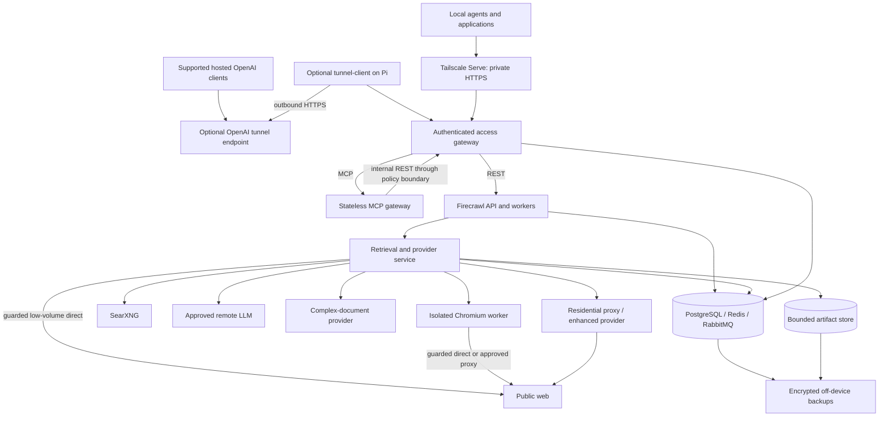
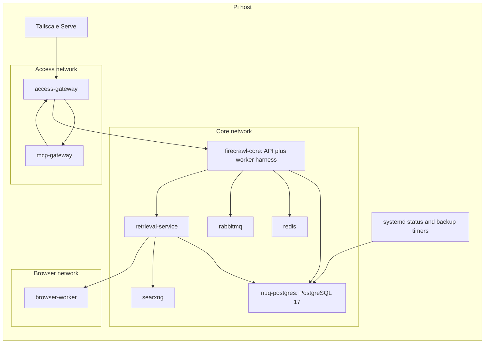
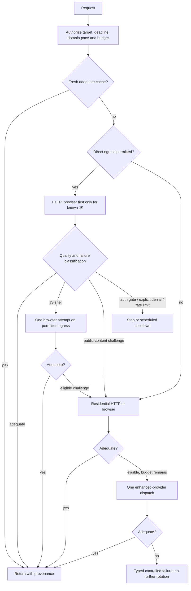
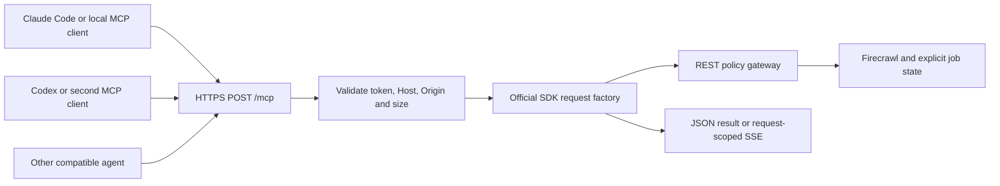
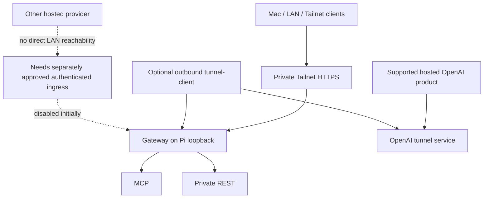
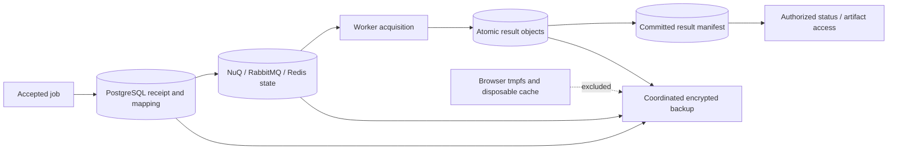

# Firecrawl Pi Platform Specification

**Canonical document:** `FIRECRAWL_PI_SPEC.md`  
**Companion:** `FIRECRAWL_PI_MILESTONES.md`  
**Specification version:** 1.0 — 2026-09-22  
**Owner:** Personal infrastructure operator  
**Target:** Raspberry Pi 5, ARM64, 8 GB RAM, always-on home network  
**Status:** Architecture ready for implementation beginning with M0; not deployed, benchmarked, or accepted. No changes to the Pi were made during specification authoring.

## Contents

[1. Executive decision](#1-executive-decision) · [2. Goals, boundaries, and use cases](#2-goals-boundaries-and-use-cases) · [3. Research baseline and version strategy](#3-research-baseline-and-version-strategy) · [4. Read-only environment audit](#4-read-only-environment-audit)

[5. Current Firecrawl service model](#5-current-firecrawl-service-model) · [6. Cloud-parity and capability matrix](#6-cloud-parity-and-capability-matrix) · [7. Target stack and architecture](#7-target-stack-and-architecture) · [8. Retrieval integration contract — the necessary custom work](#8-retrieval-integration-contract--the-necessary-custom-work)

[9. Retrieval resilience, quality, and retry policy](#9-retrieval-resilience-quality-and-retry-policy) · [10. Proxy architecture and home-IP protection](#10-proxy-architecture-and-home-ip-protection) · [11. Enhanced retrieval providers](#11-enhanced-retrieval-providers) · [12. Browser architecture](#12-browser-architecture)

[13. Search architecture](#13-search-architecture) · [14. LLM and structured extraction architecture](#14-llm-and-structured-extraction-architecture) · [15. Document parsing](#15-document-parsing) · [16. REST, jobs, tools, and agent integration](#16-rest-jobs-tools-and-agent-integration)

[17. MCP architecture and modern protocol contract](#17-mcp-architecture-and-modern-protocol-contract) · [18. Compatibility and client onboarding](#18-compatibility-and-client-onboarding) · [19. Networking, TLS, and hosted reachability](#19-networking-tls-and-hosted-reachability) · [20. Security, boundaries, secrets, and Cloud independence](#20-security-boundaries-secrets-and-cloud-independence)

[21. Storage, persistence, and data lifecycle](#21-storage-persistence-and-data-lifecycle) · [22. Raspberry Pi resource budget](#22-raspberry-pi-resource-budget) · [23. Concurrency and performance tuning](#23-concurrency-and-performance-tuning) · [24. Reliability, startup, and failure recovery](#24-reliability-startup-and-failure-recovery)

[25. Observability and operational commands](#25-observability-and-operational-commands) · [26. Backups and tested restore](#26-backups-and-tested-restore) · [27. Upgrade, rollback, and maintenance](#27-upgrade-rollback-and-maintenance) · [28. Cost model and spending controls](#28-cost-model-and-spending-controls)

[29. Configuration contract](#29-configuration-contract) · [30. Deployment directory and artifact layout](#30-deployment-directory-and-artifact-layout) · [31. Verification strategy and representative corpus](#31-verification-strategy-and-representative-corpus) · [32. Binary system acceptance criteria](#32-binary-system-acceptance-criteria)

[33. Cloud-parity scorecard](#33-cloud-parity-scorecard) · [34. Risks and mitigations](#34-risks-and-mitigations) · [35. Architecture decisions](#35-architecture-decisions) · [36. Credential gates and minimum human input](#36-credential-gates-and-minimum-human-input)

[37. Deferred enhancements and handoff readiness](#37-deferred-enhancements-and-handoff-readiness) · [38. Primary-source registry](#38-primary-source-registry)

## Reading conventions

**MUST** is a release requirement. **SHOULD** is the recommended default, changeable only with a recorded reason and regression evidence. **MAY** denotes an optional capability. Requirements in this document govern architecture; the companion governs execution order and evidence. Keep both current together rather than creating a third architecture document.

Evidence labels distinguish **[V] verified upstream behavior**, **[E] documented external-provider capability**, **[D] design decision**, and **[T] implementation validation required**. Source references `[F…]`, `[M…]`, and `[O…]` resolve in §38. Source verification is not a successful deployment test. Every parity assertion below describes a target until its acceptance test passes.

---

## 1. Executive decision

Build a **private, centrally accessible web-acquisition service**, not a public copy of the upstream development Compose stack. Keep Firecrawl's API, crawl machinery, normalization, and extraction pipeline. Add a bounded retrieval service, one isolated Chromium worker, durable data services, an authenticated access gateway, and a thin official-SDK MCP adapter.

**Selected core:** Firecrawl API-image release tag `v2.11.162`, dereferenced source commit `7666c1f9ae8720a6bba271e0f60b6a217f8a5210`; PostgreSQL/NuQ, Redis, and RabbitMQ; Docker Compose; one NuQ worker initially. The tag is the exact snapshot used by the current official self-hosting guide. It is not being represented as the latest formal GitHub Release: the Releases page inspected during research identifies `v2.11.0` separately. [V: F01–F05]

**Selected MCP:** stable **`2026-07-28`**, stateless Streamable HTTP at `/mcp`, official TypeScript SDK v2 with `@modelcontextprotocol/server@2.1.0`; SDK-provided stateless compatibility for `2025-11-25`. The modern request factory, not an old transport with its session option turned off, is the implementation model. [V: M01–M07]

**Selected gap closures:** SearXNG on the Pi; Decodo residential HTTP proxies; Zyte API pay-as-you-go enhanced retrieval; a replaceable, budgeted remote OpenAI-compatible extraction provider; native document parsing with LlamaParse as an optional-account, bounded complex-document fallback; local artifact storage; automated encrypted off-device backups. Bright Data is the alternate raw-proxy supplier, and ScrapingBee is the alternate enhanced provider. [D, with E sources in §§10–15]

**Important engineering decision:** a proxy setting or a replacement Playwright URL alone does not implement this specification. The pinned Playwright connector returns HTML/status only, and the native engine registry does not expose its screenshots/actions through that connector. Add a **small, tested, version-pinned retrieval integration patch**, with most behavior outside Firecrawl. Do not recreate Fire Engine or broadly fork Firecrawl. [V: F06–F07; D: §8]

The result can remove Firecrawl Cloud quota from the supported paths. It cannot guarantee access to every protected site, supply Cloud's proprietary indexes, or make one Pi highly available. Those limitations remain explicit rather than being disguised as completed parity.

## 2. Goals, boundaries, and use cases

### 2.1 Required outcomes

The same private service must support REST applications, Claude Code, local Codex, other MCP clients, research agents, and automation. A client can scrape a page, discover a site's URLs, launch and poll a crawl, search, and request structured data without a Firecrawl Cloud key. Difficult public pages can escalate through approved paid providers under a finite budget. A reboot must recover the service without an SSH intervention.

Priority order is retrieval quality, legitimate anti-bot resilience, useful Cloud parity, agent accessibility, modern MCP, durability, Pi stability, cost, and maintainability. Throughput is subordinate to correctness and host safety.

### 2.2 Non-goals

No Kubernetes, enterprise IAM suite, commercial billing, thousands of users, autonomous purchases, automatic public ingress, unlimited retention, large Pi-hosted LLM, credential-gate bypass, private-account scraping, paywall defeat, or stealth promises. Do not introduce Cloud fallbacks, third-party spending, or an upgrade merely because a dependency supports them. Do not reimage the Pi or displace existing services.

Cloud Browser/Interact sessions, arbitrary remote JavaScript execution, audio/video pipelines, a global research index, and a Cloud Agent API clone are not mandatory for this release. Functional substitutes and their limits are specified below.

### 2.3 Readiness levels

Use these states consistently: **DESIGNED**, **IMPLEMENTED_UNVERIFIED**, **VERIFIED_LOCAL**, **VERIFIED_LIVE**, **BLOCKED_CREDENTIAL**, **UNAVAILABLE**, and **NOT_REQUIRED**. A mock provider passing tests is not `VERIFIED_LIVE`. Initial state of this platform is `DESIGNED` throughout.

## 3. Research baseline and version strategy

### 3.1 Exact baseline

| Item | Selected baseline | Evidence and interpretation |
|---|---|---|
| Firecrawl source | `v2.11.162` → `7666c1f9ae8720a6bba271e0f60b6a217f8a5210` | Official guide's tested snapshot; annotated API-image tag dated 2026-07-30. [F01, F03] |
| Annotated tag object | `ebfe595c3e218266c627f8651ccbcbe38f4ecfdd` | Dereference this to the commit above; tag reported unsigned, not cryptographically verified. [F03] |
| Formal GitHub Release observed | `v2.11.0` | Distinct from later API-image tags. Do not conflate release channels. [F02] |
| Firecrawl Compose blob | `e2ade0104390caf31cdcae04faa619c2674dc693` | Baseline for service inventory, not the final deployment file. [F04] |
| MCP protocol | `2026-07-28` | Current stable revision verified, not an RC/draft. [M01–M03] |
| MCP server package | `@modelcontextprotocol/server@2.1.0` | Exact package version verified at its tag. It caps SDK-read request bodies and batch length, and rejects a modern request without `MCP-Protocol-Version`. Pin the matching official `core` and `node` 2.1.0 packages and the lockfile in M4. [M06] |
| Runtime family | Supported Node 22.x for Firecrawl-derived services | Upstream Dockerfiles use Node 22; resolve supported patch and immutable ARM64 image digest in M0. [F09–F10] |
| PostgreSQL | Major 17 plus `pg_cron` | Upstream NuQ Dockerfile; retain `POSTGRES_DB=postgres`. [F11] |
| Browser | Chromium bundled with the browser worker's pinned Playwright package | The browser worker is project-owned, so the project chooses its Playwright pin; upstream's `playwright-service` pin does not bind it. Pin the newest stable Playwright whose bundled Chromium contains the fix for every Chromium bug known to be exploited in the wild at build time. Resolve package/browser/base-image combination together, prove native ARM64 launch; never independently float Chromium. [F10, O01–O02] |
| Other service images | Exact compatible patch tags and ARM64 digests recorded by M0 | Registry manifests have not been executed/inspected on the Pi. No invented digest or unchecked architecture claim. |

### 3.2 Controlled upgrades

The implementation repository must contain a machine-readable `versions.lock.json` with source SHA, image registry, tag, digest, platform, package versions, browser revision, and build provenance. It is an implementation artifact, not another canonical design document. Build our images from the pinned source plus an ordered patch series. Until the first patch exists, the unpatched Firecrawl API image may instead be acquired from upstream by digest when its recorded build SHA equals the pinned commit; its provenance is that SHA and upstream's publishing run, not a reproducible build. Record patch hashes separately from upstream SHA.

M0 must recheck stable releases, security fixes, and image availability. A newer release is a candidate, not permission to silently change this baseline. Prefer a maintained security-fixed version when the pinned baseline has a relevant unresolved vulnerability; update both canonical documents and rerun affected tests before adoption. Exact runtime digests and environment inventory are discovery outputs, not user questions.

### 3.3 Findings that change the design

The guide's readiness endpoint is a heartbeat, not proof of working dependencies. Its Compose defaults publish the API broadly, give API/browser limits inappropriate for an 8 GB total host, and do not supply persistent volumes for the three primary data services. The canonical Compose must be curated rather than blindly merged. [V: F01, F04]

Do not assume `.env.example` proves an active feature. The pinned engine registry has no ScrapingBee engine; the inspected configuration/parser paths do not establish a working LlamaParse fallback from the example variable. Treat those as custom provider adapters here. The actual harness uses `NUQ_WORKER_COUNT`; environment names left over in examples are not sufficient evidence of concurrency control. [V: F05–F08, F12]

## 4. Read-only environment audit

M0 must collect, without modifying the host: distribution/version, `uname -m`, kernel, CPU/RAM, cgroup support, swap/zram, mounts, block devices, filesystem types, Docker root/data directories, available disk/inodes, Docker/Compose versions, running containers/services, listening ports, hostname, DNS, firewall backend/rules, Tailscale state, reverse proxies, thermal sensors, power/throttling flags, and current workload usage.

Useful read-only probes include `cat /etc/os-release`, `uname -a`, `free -m`, `swapon --show`, `lsblk -f`, `findmnt`, `df -h`, `df -i`, `docker info`, `docker ps`, `docker compose version`, `ss -lntup`, and available thermal/power diagnostic commands. Handle missing utilities without installing anything during the audit. Avoid dumping environment variables or secrets into evidence.

Acceptance requires actual `aarch64`/ARM64 userspace and a supported container runtime path. Do not infer current OS or boot medium from previous purchases or project interests. An incompatible/special-purpose OS, unavailable administration access, or insufficient capacity is a real host gate. Record options without reimaging.

Minimum admission to initial build: no known filesystem errors, adequate power/cooling for tests, at least **20 GiB free working space** or a measured build-storage plan that fits safely, and a projected steady-state budget fitting alongside existing services. This 20 GiB value is a project planning threshold, not a published Firecrawl minimum. Prefer building heavy native images on another ARM64 machine and transferring them when Pi build pressure would disrupt service; never assume x86 emulation is an acceptable production solution.

## 5. Current Firecrawl service model

The pinned upstream harness runs separate API, queue-worker, extraction-worker, NuQ worker(s), prefetch, and reconciler processes. The `api` container is therefore not one small Node process. With `NUQ_WORKER_COUNT=1`, include these child processes and the harness itself in memory accounting and liveness checks. The indexing worker is conditional on database authentication. [V: F08]

Use the default **PostgreSQL NuQ backend**. RabbitMQ remains because the inspected harness has a RabbitMQ path alongside PostgreSQL; do not remove it on the assumption that PostgreSQL replaces every queue component. Keep Redis until route-by-route state analysis proves otherwise. FoundationDB is experimental for this deployment and its server/init services are excluded. The API build may still contain the FoundationDB client dependency; removing the server is not equivalent to safely removing its build dependency. [V: F04, F08–F09]

Maintain the Firecrawl REST normalization layer, typed v2 request validation, crawl traversal, async status semantics, and native extraction where usable. Do not build a parallel crawler just to add proxy retries. Restrict exposed routes to the verified capability set and document unsupported options rather than passing all Cloud options through optimistically.

## 6. Cloud-parity and capability matrix

Legend: **N** native; **C** configured native; **S** additional self-hosted service; **E** external provider; **X** custom equivalent; **P** partial parity; **U** unavailable; **NR** not required. Every row is a design target; final evidence lives in the acceptance results, not in this table's confidence.

| Capability / Cloud utility | Baseline gap or dependency | Selected solution / classification | Initial-release outcome and verification |
|---|---|---|---|
| Single-page scrape | Fetch and Playwright exist | N plus guarded retrieval integration | Required; HTML/Markdown correctness, AC03 |
| Crawl | Queue/worker infrastructure must be operated | C; retain native traversal | Required; bounded graph, resume/cancel, AC04/14 |
| Map | Cloud coverage may use services/indexes absent locally | C/P; sitemap and discovered-link utility | Required local mapping, not complete global discovery, AC05 |
| Web search | Search backend and quality need configuration | C+S; SearXNG, bounded fallback interface | Required web results, AC06 |
| Batch scrape | Queue and result lifetime need durable operation | C plus durable admission | Required, AC04/14 |
| Markdown | Native conversion | N | Required; usable text, not challenge content, AC03 |
| HTML / raw HTML | Native output formats | N | Required; correct final URL and format, AC03 |
| Links and metadata | Native extraction | N | Required; provenance and redirects, AC03 |
| JSON extraction from a URL | External model needed | C+E; budgeted model endpoint | Required with credential, AC07 |
| `/extract` across explicit URLs | Model, queues; some options may depend on Cloud | C/P; bounded explicit-URL subset | Required tested subset; reject unsupported discovery modes, AC07 |
| JavaScript rendering | Browser service required | S; one isolated Chromium worker | Required, AC03/11 |
| Screenshots | Bundled connector does not provide result fields | X; browser capture plus artifact delivery and engine patch | Required viewport/full-page within bounds, AC11 |
| Page actions | Baseline engine feature gap | X/P; safe, finite read-oriented action subset | Required subset; no arbitrary JS/transactions, AC11 |
| PDF/text-heavy documents | Native parser quality varies | N/C first | Required text PDF, AC08 |
| Complex/scanned PDFs | Cloud parsing infrastructure not local | E+X; LlamaParse gated adapter | Required live fallback before full parity sign-off, AC08 |
| Office/structured files | Parser-specific support must be exercised | N/P; native where verified, same document adapter otherwise | Explicit supported-format list; no universal claim, AC08 |
| Raw proxies | Proxy triple is not universal egress control | E+X; per-request HTTP proxy transport | Required verified live egress, AC09 |
| Enhanced proxy/retrieval | Proprietary managed path not bundled | E+X; Zyte, alternate ScrapingBee | Required live fallback, AC10 |
| Domain-aware routing | Not a complete local policy subsystem | X; expiring routing records | Required, small deterministic policy, AC09 |
| Remote MCP | A transport flag alone is insufficient proof | S; thin official SDK adapter | Required centralized endpoint, AC12 |
| Stateless modern MCP | Must use correct protocol era | S; 2026-07-28 request factory | Required wire tests, AC12 |
| Legacy Streamable HTTP compatibility | Client revisions differ | C; SDK `legacy: 'stateless'` | Required 2025-11-25 test, AC13 |
| Local stdio MCP | Optional client bridge | C; same tools/service, SDK stdio entry point | Optional; never canonical topology |
| CLI | Upstream/client configuration can default to Cloud | X/C; project `fcpi` plus explicitly based SDK clients | Required private status/test commands; official CLI only after base-URL test |
| Webhooks | Delivery security and persistence are operator concerns | C+X; authenticated allowlisted outbox | Required controlled receiver proof; disabled until receiver configured, AC20 |
| Agent-style research | Cloud Agent API is separate | P; existing calling agents orchestrate search/scrape/extract | Useful workflow verified; no claim to `/agent` parity |
| Browser / Interact | Cloud browser session product unavailable in default stack | P; bounded page actions replace some useful operations | No CDP exposure or generic interactive session API in initial release |
| Product/menu extraction | Specialized service URLs are not running services | X/P; tested JSON schemas through model extraction | Optional convenience, not exact specialized backend |
| Audio/video/media extraction | External service/resources needed | U/NR; return links/metadata only | Transcription and downloads not advertised |
| Image-alt generation | Model/vision path must be verified | E/P; optional tested model transform | Not release-critical; never invent descriptions |
| Change tracking | Native feature may rely on storage/service paths | X/P; normalized-content hash and bounded textual diff | Required basic change result, no semantic-monitor parity, AC21 |
| Caching | Durable ownership, expiry, quality policy needed | C+X; object cache and metadata | Required, AC21 |
| Authentication/TLS | Development quickstart does not provide final boundary | S; private gateway + Tailnet TLS | Required from first host exposure, AC01/02 |
| Hosted agent reachability | LAN/Tailnet address alone is insufficient | E/C; optional OpenAI Secure MCP Tunnel | Account-gated; other hosts need deliberate authenticated ingress, AC22 |
| Research/developer indexes | Proprietary datasets/service cannot be assumed | P/U; ordinary search plus agent research | Index completeness/ranking parity not claimed |
| Monitoring/dashboard | Managed Cloud operations absent | X; status CLI, structured metrics, alerts | Required operational utility, AC17 |
| HA / managed SLA / enterprise controls | One home Pi is a single fault domain | U/NR | Recovery is engineered; continuous availability is not promised |

Sources for baseline distinctions: [F01, F04–F08, F12–F20]. The Cloud operating-model comparison confirms that running/configuring supporting services is the self-host operator's responsibility; a feature listed in Cloud documentation is not evidence of a working self-hosted path. [F20]

## 7. Target stack and architecture

### 7.1 Container and host inventory

| Component | Responsibility | Why it earns its place |
|---|---|---|
| Host Docker/Compose + systemd | Lifecycle and bounded resources | One-host operation without an orchestration cluster |
| Host Tailscale Serve | Private HTTPS/Tailnet reachability | Avoid public ports and duplicated TLS machinery |
| `access-gateway` | Bearer authentication, route admission, limits, REST façade, artifact access | Keep backend private and policy identical for REST/MCP |
| `mcp-gateway` | Official SDK protocol handling and tool mapping only | Restart/failure independent of REST |
| `firecrawl-core` | Pinned upstream harness/API/workers | Preserve useful existing Firecrawl functionality |
| `retrieval-service` | Retrieval waterfall, provider adapters, budgets, domain policy | Central policy for every supported acquisition path |
| `browser-worker` | Bounded Chromium execution only | Isolate untrusted web code and browser memory |
| `nuq-postgres` | NuQ and separate platform schema | Durable jobs/admission/budget metadata without another DB server |
| `redis` | Upstream state/cache/rate-limit roles | Preserve upstream contracts, with persistence and eviction discipline |
| `rabbitmq` | Upstream queue messaging | Retain actual pinned queue architecture |
| `searxng` | Private metasearch | Low fixed-cost search utility |
| Host backup/status timers | Encrypted backup, restore checks, health collection | Avoid a full monitoring cluster |
| Optional `tunnel-client` | Outbound OpenAI connectivity | Add only when the account supports it |

Provider adapters inside `retrieval-service` use distinct routes, deadlines, circuit breakers, and concurrency semaphores. An LLM/parser/search outage must not fail the ordinary fetch handler. Keep the browser, MCP, and Firecrawl processes separate; do not collapse them into an opaque all-in-one service. External provider keys belong only to their adapter, not Chromium or client machines.

### 7.2 Full architecture



### 7.3 Actual service grouping



These diagrams show logical flows, not permission to bridge all containers onto every network. §20 defines exact allowed connections.

## 8. Retrieval integration contract — the necessary custom work

### 8.1 Selected integration boundary

Add a **`pi-resilient` engine adapter** at the pinned Firecrawl scraping boundary. It calls the local retrieval service and translates its response into the actual `EngineScrapeResult` type. Register its supported feature flags honestly. Native PDF/document parsers remain available, but their downloads and external fallback decisions must pass the same safe-egress and budget policy. [D, informed by F06–F07, F12]

The pinned source points are `apps/api/src/scraper/scrapeURL/engines/index.ts` and the sibling engine implementation directories. The existing Playwright connector is a useful small contract reference, not an adequate full-capability adapter. It validates `content`, `pageStatusCode`, `pageError`, and `contentType`; it does not return screenshot/action results or reliable final-redirect provenance. [V: F07]

Our deployment mode must prevent Firecrawl from racing, retrying, or falling back to an uncontrolled native network engine after the adapter has made a decision. A retry at the queue or API layer must reuse the logical acquisition ID and remaining attempt/spend budget. Set the verified upstream `SCRAPE_MAX_ATTEMPTS=1` for this profile so the custom adapter owns its bounded waterfall; preserve native parsing while testing that this control does not cause an upstream second acquisition. Suppress feature-toggle/removal retries that would silently drop required options. Disable speculative engine racing for this profile. [F14] A provider timeout must not produce several paid calls because multiple layers independently retried it.

### 8.2 Patch scope and upgrade guard

Keep custom behavior in services/modules; keep upstream changes confined to engine registration/result translation, guarded acquisition call sites, admission-ID propagation, and capability validation needed for the selected API subset. Maintain a patch manifest describing each touched upstream symbol, reason, and test. An architecture review must justify any new scheduler, authentication rewrite, or crawler replacement; those are not implied by this specification.

A version upgrade is blocked until every patch applies cleanly and all contract tests pass. Mechanical application alone is insufficient: upstream execution order and feature flags can change without a merge conflict. Prefer submitting generally useful extension fixes upstream, but do not make project progress depend on upstream acceptance.

### 8.3 Internal retrieval API (custom, not a Firecrawl API)

`POST /internal/acquire` accepts `requestId`, `logicalAcquisitionId`, authenticated `principalId`, `jobId` when present, target URL, absolute deadline, allowed result formats, action subset, routing policy, and a budget reservation reference. Inputs are schema-validated and size-bounded. Only the core service identity may call it.

It returns final URL, target status, content type, content/artifact reference, redirect chain, selected strategy, provider/request ID when available, attempt count, measured byte count, quality verdict, cost estimate, and typed failure. Its internal strategy names are `direct_http`, `direct_browser`, `residential_http`, `residential_browser`, and `enhanced`. Do not force these names into Firecrawl's narrower `proxyUsed` enumeration; put detailed telemetry in the platform metadata and preserve the native type contract.

Requests have unique attempt IDs beneath one logical acquisition ID. Persistent atomic reservation occurs before paid dispatch. Results write to a temporary artifact, fsync/rename to the final content-addressed location, and commit metadata before the operation is reported durable. An orphan sweep reconciles interrupted writes.

### 8.4 Coverage is a release gate

The integration inventory MUST cover initial scrape URLs, every crawl page, batch members, search-result scraping, map/sitemap/robots downloads, redirects, PDF/document downloads, and browser subresources. Initial REST validation alone does not protect discovered URLs. Tests must prove the same domain pacing, SSRF rules, Cloud denylist, and attempt budget apply to each path.

If an auxiliary upstream call cannot use the adapter directly, route it through the same safe-fetch module and egress guard. Classify it as `robots`, `sitemap`, `discovery`, or `document` telemetry. If a route cannot be brought under policy, disable that route/option and report the parity gap. Do not leave a hidden bypass and claim completeness.

## 9. Retrieval resilience, quality, and retry policy

### 9.1 Routing sequence

The default is **cheapest permitted adequate result**, not blindly cheapest IP. Low-volume, unknown ordinary targets can try direct HTTP once. Known JS targets start in a browser. Sustained crawls or domains with a learned block route start through the approved proxy path; they do not burn home-IP attempts first. Browser rendering can use either direct or residential egress, so proxy and rendering are independent decisions.



### 9.2 Failure classification contract

| Observation | Classification and response |
|---|---|
| Valid public content meeting format/quality checks | Success; do not escalate just because it is short |
| JS shell, delayed client rendering, missing expected DOM | One bounded browser attempt; respect remaining deadline |
| Recognized public-content bot interstitial, including HTTP 200 challenge | Eligible block; move to a different permitted strategy, not repeat the same one |
| 401 or login/authentication redirect | `AUTH_REQUIRED`; stop. Do not treat credentials as a proxy problem |
| 403 | Inspect limited structural evidence: known public-content challenge may escalate; access denial/unknown forbidden response stops conservatively |
| 429 or explicit rate-limit page | `RATE_LIMITED`; respect Retry-After and shared domain cooldown; do not rotate IPs to evade the limit |
| 404/410 | Terminal missing content; no proxy escalation |
| Target 5xx or transient connection reset | At most one same-tier retry if budget/deadline permit; no automatic claim a proxy fixes it |
| DNS failure, TLS validation failure, private/rebound destination | Typed network/security failure; never disable TLS or use a proxy as an SSRF workaround |
| Empty HTML | Check status/type/expected shape; empty valid pages are not automatically blocks |
| Provider 401/403/402 | Provider credential/billing fault; open provider breaker, not target-domain block learning |
| Provider 429/5xx | Provider outage/rate limit; finite backoff or alternate approved provider; count dispatches |
| Parse/model error | Extraction failure, not retrieval failure; do not re-fetch the page repeatedly |
| Deadline, size, disk, memory, or spend limit | Controlled resource failure; no implicit higher-cost fallback |

Cloud's documented enhanced-mode behavior describes one escalation on selected status codes, including 401/403/429. This design intentionally does **not** copy that status-only rule: authentication gates and rate limits are treated distinctly. The equivalent utility target does not require reproducing an unsafe or wasteful retry policy. [V: F16; D]

### 9.3 Concrete default limits

A page has at most **four top-level retrieval attempts**, including any same-tier retry, and at most **one enhanced-provider dispatch**. The orchestrator can skip stages; it must not squeeze five attempts into a four-attempt limit. Provider-internal retries may be opaque and are reported as such, not falsely counted as known attempts.

Default total acquisition deadline is **90 seconds**; per-attempt ceilings are HTTP 15 seconds, local/proxied browser 30 seconds, enhanced 40 seconds, always clamped to time remaining. Default gateway/MCP synchronous deadline is 110 seconds. Use asynchronous jobs for longer extraction/document workflows; do not stretch HTTP timeouts indefinitely.

Same-tier retry backoff is jittered around 1 second, bounded to 3 seconds. Target Retry-After is honored, including a valid future date; a required wait beyond the interactive deadline yields a retryable controlled result with `retryAfter`, not sleep-until-timeout. Without Retry-After, 429 starts a 60-second cooldown, doubles on recurrence to one hour, and persists across requests/restarts.

### 9.4 Content adequacy

Adequacy uses status/type, recognized challenge structure, meaningful main-content extraction, requested selector/action outcome when supplied, and fixture-specific expected facts. Do not rely on a universal minimum character count, an LLM's assertion, or an HTTP 200 alone. Label source content as untrusted data; never execute instructions found in the retrieved page. Cache only adequate content, not a challenge/login page or provider error.

A returned result must preserve source/final URL, retrieval time, content type, cache status, and whether a partial result or unsupported requested format occurred. Unsupported mandatory formats fail explicitly; they are not silently dropped.

### 9.5 Domain learning

Persist up to 5,000 small records keyed by normalized registrable domain plus scheme/port where relevant, route requirement, geo policy, and coarse format/rendering class. Distinguish a domain-wide block from a single authenticated path. Store counters, last success, last failure class, preferred tier, cooldown, and expiry. No ML model is needed.

Require two consistent observations before changing a domain preference, except an immediate protective cooldown on a clear block/rate limit. Preference TTL is 24 hours, max seven days with ongoing successes. After expiry, one bounded cheaper probe is permitted if policy allows; never probe a credential gate. Provider failures must not poison domain records. Overrides are explicit, finite, and audited.

## 10. Proxy architecture and home-IP protection

### 10.1 Provider selection

| Architecture/provider | Assessment | Decision |
|---|---|---|
| Decodo rotating residential | Published PAYG $4/GB, no monthly commitment; HTTP(S)/SOCKS5, rotation/session and geographic controls documented | Preferred raw proxy. Use HTTP CONNECT first; verify actual account minimum, expiration, and allowed use before activation. [E: O03–O04] |
| Bright Data residential | PAYG available; page shows $8/GB reference price and a lower promotional price; geographically flexible | Alternate provider. Plan conservatively at $8/GB, not a permanent promotion. Account access/KYC and routing details must be checked. [E: O05] |
| ISP/static residential | More stable address/session, but may require dedicated capacity or commitments | Evaluate only for a demonstrated repeat-domain need; not a default subscription |
| Datacenter proxy | May suit routine offloading but does not itself solve difficult residential-reputation blocks | Optional future cost optimization after measured corpus results |
| Mobile proxy | Additional expense/complexity with no initial requirement | Not selected |

Vendor-advertised success percentages are not independent measurements. The preferred choice is based on documented capability, low commitment, and integration simplicity; success on the user's corpus must be measured. Use ethically sourced/consented pools according to supplier terms. No provider is pre-authorized for purchase by this document.

### 10.2 Egress policy

Default direct allowance: **one top-level request in flight per registrable domain**, at least **two seconds** between navigations, no more than **20 direct navigations per domain per hour**, and **200 direct navigations/day across the platform**. These are project defaults, not a statement that a target permits that load. Site-specific published restrictions and Retry-After can only tighten them.

A crawl requesting more than 20 pages, a repeated-domain job beyond these limits, or a domain with an active block preference requires approved proxy egress from the start. With no proxy credential/budget, queue or return `PROXY_REQUIRED`; do not silently spill traffic onto the home IP. A `local-only` request explicitly opts out of paid escalation but never opts out of direct limits.

Pacing applies across **all** egress IPs and clients. Residential rotation is used for transport reliability, not to multiply a site's rate limit. Keep one sticky exit for a browser context, its redirects, cookies, and subresources. Rotate between independent acquisitions when appropriate, not halfway through an interactive page. Geo routing is unset unless requested and justified; record the actual supported region and fail rather than pretend unsupported precise geography.

### 10.3 Actual integration

`PROXY_SERVER`, `PROXY_USERNAME`, and `PROXY_PASSWORD` are verified in the upstream Compose/example and are used for its browser service. They are not evidence that ordinary Fetch, sitemap downloads, search, or PDFs all use the same proxy. Our HTTP and browser adapters explicitly select and verify transport on each permitted path. [V: F04–F05, F07]

Do not allow clients to provide arbitrary proxy servers or credentials. Configure providers centrally, keep proxy auth out of URLs/logs, validate certificates, and forbid credential forwarding to target origins. Measure **all** provider-accounted traffic, including browser subresources and uploads where applicable. Application byte counts are estimates until reconciled with provider usage.

## 11. Enhanced retrieval providers

**Primary: Zyte API PAYG.** Integrate as an external provider adapter, not a presumed Firecrawl-native engine. Choose HTTP response content for non-JS retrieval or browser HTML for rendering; do not request extra extraction, screenshots, actions, or geo options merely because they are available. The HTTP API returns a Base64 body, so decode with a size limit and validate MIME/status before processing. [E: O06–O08]

Only one enhanced dispatch is allowed per page within the overall four-attempt cap. An explicitly approved alternate can replace that dispatch when the primary is already unhealthy; it cannot become an unbounded second enhanced stage. Record requested features, provider request ID, target outcome separately from provider HTTP outcome, reserved cost, and billable usage where available.

**Alternate: ScrapingBee.** Its inspected pricing includes a $19/month Hobby plan with 75,000 credits; browser/proxy options consume credits differently. That fixed fee is less attractive for an infrequent safety net than PAYG, but it remains an interchangeable fallback contract. Do not infer current credit multipliers from an old blog or the stale example variable. Live adapter tests and an account rate card precede activation. [E: O09]

Provider breakers open after three provider-level failures in 60 seconds, pause five minutes, and permit one half-open probe. These values are defaults, tunable from evidence. Direct/basic retrieval remains available during a provider outage where direct policy allows it. A difficult site can still fail; return `BLOCKED_PUBLIC_CONTENT` or another accurate class, not “anti-bot solved.”

## 12. Browser architecture

Use one browser-worker container running a supported pinned Chromium/Playwright combination natively on ARM64. Supported Linux ARM64 platforms are documented, but our exact image's native modules, browser binary, sandbox, and launch must be tested. The upstream Dockerfile installs Chromium and runs as `node`; do not assume that proves a complete untrusted-site security boundary. [V: F10, O01–O02]

Start with **one browser process, one active context/page**, a bounded queue, `init: true`, explicit shared-memory allocation of 256 MiB, and a 1,536 MiB cgroup memory cap. Contexts are disposable per acquisition; keep the process warm, recycle after 50 pages or 30 minutes, or earlier after corruption/pressure. Close pages/context in `finally`, terminate a stuck page at deadline, and restart the worker if cleanup fails within five seconds. Contexts never outlive 120 seconds in this release.

Prefer non-root execution with a functioning Chromium sandbox and a reviewed compatible seccomp/user-namespace configuration. Do not use `--privileged`, Docker socket mounts, host networking, host IPC, or an automatic `--no-sandbox` workaround. If the sandbox cannot run safely on the audited host, record a browser security gate and use approved external rendering until a safe host configuration is available.

Block audio/video, downloads, and known unnecessary large media by default. Preserve scripts, styles, and content images required by the requested format; screenshots require images. Bound aggregate subresource bytes and requests, with **200 subresources / 25 MiB per page** as starting limits. An incompatible page yields a resource-limit result or an explicit approved larger profile, not unlimited loading.

The action subset is `wait`, selector wait, scroll, click for public navigation/expansion, screenshot, and content capture. At most 10 actions and 15 seconds of explicit waits; all activity shares the acquisition deadline. No arbitrary `executeJavascript`, shell, uploads, checkout, account changes, credential filling, or unrestricted cross-origin action chains. Browser input/execution features outside this subset fail with a precise unsupported-capability result.

Screenshots are stored outside the database as bounded artifacts: viewport or full-page up to 20,000 px height and 10 MiB encoded output. Return dimensions, truncation status, MIME type, and authenticated artifact reference. Do not call a clipped image an unqualified full-page capture. Native output shape compatibility and MIME bytes must be tested.

## 13. Search architecture

Run a private SearXNG instance on the Pi with JSON output explicitly enabled in `settings.yml`; an unset JSON format can itself cause a 403, which is a local configuration issue rather than target anti-bot blocking. Use a small engine set validated by M5, one application worker initially, a 10-second query deadline, no public UI, and no unrestricted external access. [V: O10]

The inspected native search function selects Fire Engine if configured, then SearXNG, then a direct DuckDuckGo path in some circumstances. Therefore simply setting `SEARXNG_ENDPOINT` does not establish a complete controlled-fallback policy. Route the endpoint through a SearXNG-compatible adapter in `retrieval-service` and suppress unmanaged fallthrough in the selected deployment profile. [V: F13]

Default result count is five, maximum ten. Cache identical normalized query/language/category/time-filter requests for 15 minutes. Do not cache a backend outage as a legitimate zero-result query. Record search engine failures separately from empty results; a working engine can return valid results while another is blocked. Keep a bounded hourly query rate of 60 until tuning supports a higher value.

A **SearchAPI adapter** is a supported extension if local search reliability proves inadequate. `SEARCHAPI_API_KEY` in the example is not proof that all current v2 routes honor it. Its activation requires a verified API contract/rate card, explicit budget, and live test; no search subscription is mandatory initially. The initial release must pass the local search test without depending on Firecrawl Cloud. [V: F05; D]

Map is not synonymous with web search. Preserve sitemap/discovered-link mapping without SearXNG; prove it still works during a search outage. Mark search-index augmentation unavailable when its backend is unavailable. Do not claim to enumerate all URLs of a site.

## 14. LLM and structured extraction architecture

Run no general-purpose LLM on the Pi. Use the existing Firecrawl OpenAI-compatible configuration, backed by a small budget-enforcing provider adapter. Preferred conservative baseline is **`gpt-4.1-mini-2025-04-14`**, selected for an explicit non-reasoning structured-output contract and predictable billing, not as a claim that it is the newest or strongest model. Current official pricing lists $0.40/M input and $1.60/M output tokens for GPT-4.1 Mini. [V/E: F05, F14, O11]

The adapter must allow model replacement without changing MCP tools. A LAN-hosted compatible model on another personal machine or Ollama is an alternative only when the actual endpoint passes schema, latency, token accounting, and failure tests. If that machine sleeps, acquisition without extraction must continue normally. Avoid a dependency on the Mac being awake.

Set an allowlist of model IDs and endpoints; reject unexpected hard-coded model requests rather than silently forwarding them to an expensive model. Verify every enabled Firecrawl AI path against the selected base URL with an instrumented fixture. Native configuration names do not prove every specialized Cloud path is routed through them. Disable unsupported paths and report the limitation.

Expose a narrow OpenAI-compatible internal forwarding endpoint for the required chat/structured-output and, only if exercised, embedding operations. Native services receive a local service credential, not the external provider key. The adapter holds the actual provider secret and reserves the maximum configured token cost before forwarding. Log token counts/model/cost, never prompts or complete scraped content by default.

Extraction defaults: maximum 32,000 input tokens per logical extraction unit, 4,000 output tokens, one active model request, at most one schema-repair call inside the same budget. Chunking is explicit and preserves page/URL provenance; missing fields are null/omitted according to the schema, never invented. Validate output against JSON Schema. Disallow remote schema references, enforce schema depth/size limits, and prevent scraped content from controlling tools or provider destinations.

For `/extract`, support explicit bounded URLs, prompt/schema, polling, and partial-failure reporting first. Multi-site autonomous discovery or Cloud research features are not silently emulated through a different API. Embeddings, image-alt generation, and semantic transforms are capability-gated; no embedding daemon or vector database is required merely to serve the basic acquisition use case.

## 15. Document parsing

Preserve the pinned native PDF/document path for ordinary files. Source inspection shows native PDF processing and optional FirePDF/RunPod paths, not a demonstrated active LlamaParse adapter from the example key. Do not enable proprietary endpoints or accidental paid GPU services. Add LlamaParse deliberately as a provider adapter. [V: F12, F17]

Download through guarded acquisition, detect MIME from bytes as well as headers, cap default PDF input at **25 MiB and 100 pages**, disable active content, and bound parser CPU/time/temp storage. Preserve page boundaries and provenance. Basic text PDFs use local parsing. Complex layout, scan/no-text detection, or native-quality failure can request the external fallback only when a credential and budget exist.

For LlamaParse use v2 **Cost-effective** initially (three credits/page), **Agentic** only for a measured complex-document requirement (10 credits/page). Agentic Plus and paid presets are not automatic. Published conversion is 1,000 credits = $1.25. The inspected free plan includes 10,000 credits; its pricing page says an upgrade to Starter is needed for PAYG, so do not budget as though unlimited no-commitment paid parsing is guaranteed. Starter is listed at $50/month. [E: O12–O13]

Cache by document bytes hash, parser/version/options, and owner. Prefer ephemeral uploads and delete retained provider files when no longer needed; document provider retention and any storage charges. A parser outage must not disable HTML scraping or local PDF parsing. A scanned PDF with no enabled fallback returns `PARSER_REQUIRED`, not empty “successful” Markdown.

Test a text PDF, multi-column/table PDF, scan-only PDF, password-protected PDF, malformed PDF, misleading MIME, and oversized file. Required native formats beyond PDF are only those actually verified in M5; optional Office formats can use the same guarded parsing adapter. Do not grant a remote MCP client arbitrary access to local filesystem paths through a parsing tool.

## 16. REST, jobs, tools, and agent integration

### 16.1 Public-to-trusted-client API contract

The private gateway exposes a **Firecrawl-compatible v2 subset**, not an unqualified clone of every current Cloud endpoint. Preserve the pinned request/response schemas for supported routes and options; maintain contract fixtures using a pinned compatible Firecrawl client. The gateway must reject unsupported formats/options explicitly before charging or enqueuing work. Rewrite returned pagination/status/artifact URLs to the approved private origin; never return an internal container hostname or Cloud API URL.

| Interface | Initial contract |
|---|---|
| `POST /v2/scrape` | Bounded synchronous scrape; native supported formats/options; 90-second acquisition budget inside a 110-second gateway deadline |
| `POST /v2/crawl`; status/cancel routes | Native bounded crawl, externally stable job ID, status/results pagination and cancellation |
| `POST /v2/map` | Native sitemap/discovered-link map; bounded URL count and acquisition policy |
| `POST /v2/search` | SearXNG-backed results; requested result scraping uses the same guarded acquisition path |
| `POST /v2/batch/scrape`; status/cancel routes | Bounded list of URLs, per-item outcomes, explicit job ID |
| `POST /v2/extract`; status route | Explicit-URL extraction subset, model budget and schema validation |
| `/platform/v1/status` | Authenticated capability/health summary; no secrets or page contents |
| `/platform/v1/jobs/{id}` | Durable receipt, upstream mapping, recovery state, expiry, errors, and result references |
| `/platform/v1/artifacts/{id}` | Authorized bounded artifact download; owner and expiry checked |
| `/platform/v1/changes` | Custom normalized-content comparison; explicitly not Firecrawl Cloud Monitor |

M1/M3 must verify the pinned methods and route suffixes for every native status/cancel endpoint. Generate bindings from that checked contract; do not guess that every asynchronous feature uses identical URL shapes. Extensions are namespaced under `/platform/v1`, not passed off as new upstream options. A capability manifest records supported route/option combinations, schema hashes, limits, and evidence state.

Set `FIRECRAWL_API_URL` explicitly in clients that support it; library constructor options must likewise set the actual base URL. A client-side environment name is not necessarily a Firecrawl server variable. For project clients, missing/invalid base URL is a startup error, not permission to use a vendor default. Use separate local gateway credentials rather than a Firecrawl Cloud key.

### 16.2 Durable admission and idempotency

Before acknowledging an asynchronous submission, persist a platform receipt in PostgreSQL with owner, canonical request hash, external job ID, optional client idempotency key, deadlines, limits, budget references, and submission state. The durable external ID is a UUID mapped to the upstream ID; compatible status routes resolve it transparently. Keep a native response's documented schema and success status when the upstream submission is confirmed; never report an ambiguous upstream submission as a confirmed running crawl.

A pending/uncertain enqueue is exposed through the custom receipt endpoint and a documented retryable native-route error containing the receipt reference. A client retry with the same idempotency key returns the same receipt. The upstream-admission integration must persist a unique logical submission key before scheduling and deduplicate retries against it. A reconciler repairs the ledger/upstream mapping after a crash. If that cannot be done safely, retain `SUBMISSION_UNCERTAIN` and do not launch a second paid job merely to make the UI look healthy.

State transitions are `RECEIVED → SUBMITTING → QUEUED → RUNNING → SUCCEEDED | PARTIAL | FAILED | CANCELLED`; `SUBMISSION_UNCERTAIN` is recoverable, and `EXPIRED` distinguishes expired results from an unknown ID. Record transition timestamps. A native queue retry reuses the same logical page acquisition ID and charged/reserved spend ledger.

Idempotency keys are scoped to principal and operation for 24 hours. A reused key with a different request hash returns conflict. An MCP JSON-RPC request ID is **not** an application idempotency key. Read-only lookup retries are safe; job submissions need explicit idempotency. The platform promises durable receipt tracking and bounded at-least-once processing, not exactly-once interaction with external providers.

Persist completed result manifests and content references before marking platform completion. Result pagination follows the native `next` URL, which the pinned official client follows verbatim, so cursors are the native offsets rather than opaque tokens: a finished job's `skip` indexes its archived documents in their committed order, which no gateway or MCP restart and no core-side expiry changes, while a running job's offset is the core's own, passed through. Cursors are owner-bound because every lookup is by the presenting credential's principal, and another principal's job answers exactly as an unknown one does. Default retention is seven days for result content and 30 days for job metadata. Upstream Redis/queue expiry must not silently shorten the advertised platform retention; archive or return the durable result through the gateway when native state expires.

### 16.3 MCP tool surface

Retain recognizable official Firecrawl tool names where their semantics match. The current official MCP package was inspected as `3.24.1`, using FastMCP `4.3.2`; an HTTP configuration flag by itself does not establish the modern wire contract required here. Our thin adapter therefore uses the official Tier 1 SDK directly, while preserving useful tool conventions. This is not a claim that the current Firecrawl MCP server is inherently incapable of modern support. [V: F21]

| Tool | Mapping | Notes |
|---|---|---|
| `firecrawl_scrape` | `/v2/scrape` | Native supported options, including the tested screenshot/action subset |
| `firecrawl_map` | `/v2/map` | Limit and provenance preserved |
| `firecrawl_search` | `/v2/search` | Search and optional result scraping distinguished |
| `firecrawl_crawl` | Crawl submit | Returns explicit job ID immediately after durable admission |
| `firecrawl_check_crawl_status` | Crawl status | Bounded paginated result, no long polling loop hidden in tool |
| `firecrawl_cancel_crawl` | Verified cancellation route | Platform addition; idempotent logical cancellation |
| `firecrawl_batch_scrape` / `firecrawl_batch_status` | Batch submit/status | Platform extensions; do not claim these are current official MCP tools |
| `firecrawl_extract` / `firecrawl_extract_status` | Extract submit/status | Platform extensions for the supported explicit-URL subset |
| `firecrawl_get_result` | Platform job/artifact lookup | Owner-bound pagination; avoids enormous tool messages |
| `firecrawl_capabilities` | Platform status/capabilities | Compact operational capabilities, not an admin/control shell |

Only register enabled capabilities. During a temporary provider outage, retain a configured tool's stable schema and return a precise unavailable/budget error; do not continuously reorder the catalog. A permanently unconfigured capability may be omitted, and the manifest must say why. Sort tools deterministically. Large content returns a bounded excerpt plus authorized artifact/result handles; default tool text payload is at most 256 KiB, with pagination rather than silent truncation.

Tool annotations must be honest: acquiring public information is read-oriented toward the target but can consume budget and create local jobs. Cancellation changes job state. An `openWorldHint` or read-only annotation is not authorization and must never bypass policy. No tool returns provider credentials, exposes a shell, browses arbitrary local files, or opens a generic CDP browser session.

## 17. MCP architecture and modern protocol contract

### 17.1 SDK selection

| Official SDK considered | Verified protocol position | Decision |
|---|---|---|
| TypeScript v2 | Stable 2026-07-28 implementation; request-factory HTTP entry and stateless older-era compatibility | **Selected.** Shares JSON types/tool contracts with the Firecrawl-derived stack and avoids a new application language/runtime family. |
| Python v2 | Current stable line supports 2026-07-28 and earlier revisions | Valid alternative, especially for a Python-heavy host. No benefit here sufficient to offset another application dependency stack. |
| Go | Official SDK supports the current revision, with migration/compatibility guidance | Attractive small-runtime alternative; no measured Pi footprint comparison was performed. Additional REST/schema integration work outweighs an unmeasured efficiency advantage initially. |

All three were evaluated as maintained official choices, not rejected on language preference alone. [V: M05–M07] Pin `@modelcontextprotocol/server@2.1.0` with `@modelcontextprotocol/core@2.1.0` and `@modelcontextprotocol/node@2.1.0`, and their resolved integrity hashes. M0/M4 must check security-maintained patches and API compatibility before freezing the implementation lockfile.

### 17.2 Request lifecycle

Use `createMcpHandler(factory)` from `@modelcontextprotocol/server`, mounted on Node through `toNodeHandler` from `@modelcontextprotocol/node`. The factory constructs/registers a fresh `McpServer` for each HTTP request. Shared HTTP/database connection pools are permitted; a shared MCP session registry or long-lived `McpServer` instance is not. The framework handler is not itself a security boundary: authentication and Host/Origin validation must run first. [V: M07]



The selected modern profile requires the following contract, implemented through SDK serializers/validators rather than a home-grown protocol stack. [V: M01–M04, M07]

| Concern | Required behavior |
|---|---|
| Protocol state | No protocol-level session, no generated `Mcp-Session-Id`, no required modern `initialize` or `notifications/initialized` exchange |
| Request metadata | Carry protocol version and client capabilities in the standardized `_meta` envelope; identify the client per request where provided |
| Discovery | Implement `server/discover`; clients need not call it before every request or before a direct compatible tool call |
| Server identity | Use the selected SDK's current result metadata location, not an obsolete assumed discovery-body field |
| Results | Current `resultType` and required cacheability fields emitted/validated by the official SDK |
| Transport | POST to `/mcp`, accept ordinary JSON and request-scoped SSE; no standalone legacy HTTP+SSE endpoint |
| HTTP metadata | `MCP-Protocol-Version`, `Mcp-Method`, and method-applicable `Mcp-Name` validated against the body |
| Catalogs | Deterministic order; 60-second suggested freshness, private cache scope for authorized catalogs, no authorization-dependent shared cache leaks |
| Long-running work | Application job IDs and bounded polling, not hidden MCP session state or mandatory experimental task extensions |
| Cancellation | Abort request-local work using current transport semantics; explicit crawl cancellation is a separate durable operation |

For wire assertions, the exact request keys in `params._meta` are `io.modelcontextprotocol/protocolVersion` and `io.modelcontextprotocol/clientCapabilities`; `io.modelcontextprotocol/clientInfo` identifies a client when supplied. The corresponding server identity key is `io.modelcontextprotocol/serverInfo` in result metadata. `Mcp-Method` must agree with the JSON-RPC method; method-applicable `Mcp-Name` must agree with the invoked tool/resource/prompt. Use the SDK's standardized mismatch/unsupported-version errors. Authenticated modern GET/DELETE requests must not establish a legacy session; this profile has no separate GET event stream. [M02–M03, M07]

Do not copy snippets from an older SDK and assume upgrading the package changes their wire behavior. The official migration guide explicitly distinguishes the modern handler entry from older hand-constructed transports. [M07]

### 17.3 Independence and cancellation

```mermaid
sequenceDiagram
    participant A as Agent
    participant M as MCP process
    participant G as REST gateway
    participant D as Durable jobs
    A->>M: Independent POST crawl + auth + modern metadata
    M->>G: Submit with application idempotency key
    G->>D: Persist receipt and upstream mapping
    D-->>A: Explicit crawl/job ID via response
    Note over M: MCP process stops and restarts
    A->>M: New TCP connection, POST status(job ID)
    M->>G: Authorized status lookup
    G->>D: Resolve owner-bound job ID
    D-->>A: Status/results; no protocol session recovery
```

For a synchronous scrape, propagate request abort to pending browser/network work; persist any already-incurred charges. For an already accepted asynchronous crawl, closing the submission response does not cancel the crawl. A retry uses the same application idempotency key. `firecrawl_cancel_crawl` persists cancellation intent, stops new page dispatches, and bounds termination of active work. Browser/provider cancellation may not reverse an external charge; report that distinction.

Modern Streamable HTTP cancellation closes the current response stream under the SDK's transport semantics. Do not claim `Last-Event-ID` will resume that stream. Lost responses are handled by a new request and explicit application IDs, not replayed protocol sessions. [M02–M03, M07]

### 17.4 MRTR and extensions

**Do not implement MRTR for the initial Firecrawl tools.** All required inputs can be given directly or referenced by a job handle; the platform calls its approved LLM API directly rather than requesting client sampling. Unknown provider credentials are setup gates, not a reason to start runtime elicitation flows. Do not add deprecated Roots/Sampling/Logging features. Discovery advertises only actual capabilities. A future MRTR feature must use the official SDK, owner-bound expiring continuation state, and idempotent side effects; it must not smuggle in an MCP session. [M02, M07]

## 18. Compatibility and client onboarding

Use the SDK's **`legacy: 'stateless'`** behavior at the same `/mcp` endpoint for `2025-11-25`. Older clients may perform their older initialization exchange, while modern requests use the current per-request envelope. There is no requirement to hold a persistent GET/SSE stream or remember an MCP session between requests. Do not manually rewrite legacy JSON-RPC messages. Features requiring legacy server-to-client return channels are not needed and are not promised. [M04, M07]

Modern conformance tests must explicitly pin the client to `2026-07-28`; the SDK's default client behavior can otherwise exercise only the older era. Record the observed protocol from validated requests, not a UI label. Test a separate older client pinned to `2025-11-25`. Malformed modern metadata/header mismatches must be rejected by the modern path, not routed as a legacy request. Authentication failures must not trigger protocol downgrade.

Each real client gets a name, separate revocable token, allowed tool scopes, explicit base URL, observed protocol revision, and a fixture invocation result. Use the current installed client configuration schema rather than hard-coded historic configuration-file paths. Claude Code and Codex should use the centralized remote endpoint where supported; optional stdio uses the same tool factory and private service, not a separate scraping stack.

Require two independent clients in M4/M9, with at least one real target client when available. An official SDK test client can establish wire behavior but must not be reported as a successful ChatGPT, Claude Code, or Codex integration. If a target product cannot negotiate the current revision, retain tested legacy compatibility and label its actual revision. If a client requires a deprecated SSE-only server, prefer upgrading that client or an explicitly isolated bridge; do not change the canonical endpoint.

## 19. Networking, TLS, and hosted reachability

### 19.1 Private default

Bind the gateway's host publication only to loopback, with a non-conflicting port discovered in M0. Tailscale Serve terminates HTTPS and forwards to that gateway. Tailnet ACLs/grants restrict access to approved user devices; gateway bearer authentication remains enabled. Do not expose the native Firecrawl port, Redis, RabbitMQ management, PostgreSQL, SearXNG UI, or browser debugging port. Tailscale Serve is private connectivity, not a way for arbitrary hosted services to reach a Tailnet address. [V: O14; D]

For local clients that cannot use Tailscale, prefer a deliberately configured LAN HTTPS path with the same application authentication. Plain HTTP is acceptable only over host loopback or explicitly isolated service networks; do not silently weaken TLS for remote clients. Certificate expiry and renewal failure are observable operational events.

### 19.2 Hosted access without opening the Pi

**Preferred optional OpenAI route:** use OpenAI Secure MCP Tunnel when the user's platform organization, product, and account controls support it. The documented tunnel client makes outbound requests and forwards them to a local MCP endpoint, avoiding an inbound public Pi port. It is an OpenAI-specific reachability option, not a universal bridge for all hosted agents. Account permissions, tunnel association, and the actual ChatGPT/API product surface must be verified. [V: O19–O20]

The tunnel client uses a dedicated local gateway credential and bounded tool scopes; the tunnel's API key is distinct from LLM billing and Firecrawl credentials. Pin its release/digest, verify forwarding of modern headers and JSON/SSE, and run the same authentication/cloud-independence tests. Keep tunnel availability out of the core readiness dependency graph. Do not assume its existence enables custom MCP tools in every ChatGPT mode.

For a different hosted agent that cannot join the Tailnet, the approved migration path is an outbound tunnel or HTTPS reverse-proxy ingress with **MCP-compatible OAuth authorization**, not an unauthenticated public URL. Cloudflare Tunnel or Tailscale Funnel can be evaluated as transport options, but neither replaces application authentication. They are not selected or activated by this specification. A browser-only access challenge or a service-token mechanism unsupported by the actual MCP client is not a complete interoperability solution.



### 19.3 Public OAuth profile, only when deliberately enabled

Treat the MCP gateway as an OAuth resource server. Use a maintained authorization service rather than implement a new identity product. Validate issuer, audience/resource, expiry, signature or introspection result, and scopes. Publish required protected-resource metadata and compatible authorization-server metadata; support the selected client's redirect/PKCE flow and registration method. Use current Client ID Metadata Documents where supported; legacy DCR is compatibility-only, not the basis of a new deployment. Never pass an incoming MCP token through to Firecrawl, a target website, or a paid provider. [V: M08]

The initial Tailnet bearer-token profile is an out-of-band trusted-client authentication choice, **not a claim of full public OAuth flow conformance**. A hosted product requiring OAuth must pass its end-to-end OAuth tests before use. OpenAI tunnel transport does not automatically make an otherwise private OAuth authorization server reachable to a user's browser. [M08, O19]

## 20. Security, boundaries, secrets, and Cloud independence

### 20.1 Allowed service connections

| Caller | Allowed destination | Boundary |
|---|---|---|
| Host Tailscale/tunnel client | Access gateway only | Loopback, configured credential and identity |
| Access gateway | MCP, Firecrawl REST, platform DB, artifact store | Separate service credentials; no browser control or provider secret access |
| MCP gateway | Access gateway's internal REST route | Fixed destination; credential delegated from validated owner/scopes |
| Firecrawl core | PostgreSQL, Redis, RabbitMQ, retrieval service | No unconstrained direct Internet target access |
| Retrieval service | Browser, SearXNG adapter, approved provider APIs, guarded web egress | Per-module credentials, budgets, and URL validation |
| Browser worker | Guarded target/proxy egress; retrieval controller | No data-service access, no Docker socket or host mounts |
| SearXNG | Approved search engines through egress policy | Query limits; no LAN/metadata targets |
| Backup process | Quiesced data/config and approved backup destination | Host-owned credentials not exposed to application containers |

Use user-defined isolated networks plus host egress enforcement appropriate to the actual Docker firewall backend. A Docker bridge marked `internal` is useful but not a substitute for permitting required provider traffic through a controlled path. Verify actual packets/connection logs from each role. Published Docker ports can interact unexpectedly with host firewall assumptions; inspect effective rules rather than relying on UFW alone. [V: O15]

### 20.2 SSRF and untrusted content

Validate every target URL and every redirect, sitemap link, webhook destination, parser download, browser navigation/subresource, and provider callback. Allow HTTP/HTTPS only, normally ports 80/443. Reject userinfo, ambiguous host encodings, loopback, link-local, private ranges, multicast, local service names, Tailnet addresses, and cloud metadata addresses for user-supplied targets. Enforce both IPv4 and IPv6, including mapped/alternative encodings.

Resolve and validate addresses immediately before connecting and pin/validate the connected destination to prevent DNS rebinding. Browser subresource interception must share the same rule, and network enforcement must block bypasses such as WebRTC/direct UDP or a service worker fetching a private target. A cross-origin redirect requires fresh validation and removal of sensitive headers/cookies. Untrusted input cannot alter proxy credentials, provider endpoints, internal headers, filesystem destinations, or permitted service URLs.

Internal service URLs and an isolated fixture network are explicit deployment-controlled exceptions, never caller-selected global `allowLocal` settings. The fixture exception holds only for work that begins at a fixture target: a redirect chain or rendered page that begins at a public URL cannot reach the fixture network. A proxy does not excuse validation: the provider may resolve a URL differently, so reject non-public/ambiguous targets before dispatch and constrain redirects where supported. Unknown unsafe behavior fails closed.

Treat page content as data. Do not execute instructions from fetched pages, shell fragments, or extracted JSON. Keep raw HTML inert when serving it: download attachment or safely rendered text, not executable same-origin HTML in the gateway. Set appropriate MIME and content-disposition headers. Browser actions remain the safe subset in §12.

### 20.3 Authentication and secrets

Issue separate high-entropy revocable bearer tokens per client, store only verification hashes where possible, compare safely, and scope write-like operations such as cancel/admin separately. Missing/invalid tokens return 401; insufficient scope returns 403. Authorize every job/artifact lookup against the credential-derived principal. MCP client identity metadata is descriptive, not proof of identity. Strip external attempts to spoof internal principal/request headers; regenerate them at the trusted boundary.

Validate allowed Host and Origin values. Native non-browser agents may omit Origin; unexpected browser Origins are rejected. Do not enable wildcard credentialed CORS. Rate-limit authentication failures and cap body/header sizes before expensive parsing. Apply a 1 MiB default request-body cap and reject oversized JSON schemas/URL arrays early.

Store service secrets under `/etc/firecrawl-pi/secrets/`, directory mode 0700 and files 0600, owned by the relevant service administrator. Mount read-only secret files where supported; an entrypoint may load them into process environment for upstream code that lacks `_FILE` support. Do not invent upstream `_FILE` variables. `.env` is 0600, excluded from Git and normal configuration exports. Docker environment inspection is privileged and must never be copied unredacted into reports.

Rotate a client token by creating its replacement, testing it, switching the client, then revoking the old token. Rotate provider/database credentials with a bounded overlap or coordinated restart according to the actual service's capability. Back up credentials only in a separate encrypted recovery set with an independently held recovery key; exclude them from ordinary logs, diagnostics, and plaintext repository backups.

### 20.4 No accidental Firecrawl Cloud use

No Firecrawl Cloud key is configured in the production profile. Clients must set a self-hosted base URL explicitly, and the MCP adapter uses a fixed local REST endpoint. Disable Cloud-hosted specialized/index services unless individually approved and marked outside this platform's quota-independent capability set. The pinned `AGENT_AUTH_RESOURCE_METADATA_URL` defaults to Firecrawl Cloud; generate gateway-owned authentication errors and remove inherited Cloud `WWW-Authenticate` metadata/redirects so clients do not initiate Cloud authorization discovery. An enabled OAuth profile must advertise its own approved protected resource. [F14] Do not reuse the official hosted MCP OAuth/API configuration merely because it works against Cloud. [F21]

At runtime, apply an explicit service-destination policy: core/MCP cannot contact arbitrary public APIs; provider adapters contact only approved providers; target acquisition rejects Firecrawl Cloud API/MCP service destinations by normalized host policy. Include `api.firecrawl.dev` and official hosted Firecrawl MCP endpoints in the denylist, discovered and updated during source review. DNS denial alone is not considered sufficient evidence: test configured SDK destinations, redirects, alternate endpoint options, and outbound connections through the actual runtime transport.

AC24 runs with all Firecrawl Cloud service destinations deliberately unavailable and a sentinel Cloud credential that must never be used. Every selected local operation still passes, and instrumented outbound logs show **zero attempted Cloud service calls**. External OpenAI LLM/tunnel, proxy, Zyte, and LlamaParse calls remain separately labeled external-provider use, not disguised as fully offline operation.

## 21. Storage, persistence, and data lifecycle

### 21.1 Storage choice

Discover the actual boot and data devices in M0. **Required:** persistent mounts, free-space/inode checks, bounded writes, tested backups, and safe mount ordering. **Strongly recommended:** SSD/NVMe for databases, Docker data, result artifacts, and sustained logs. **Optional:** boot migration, a larger SSD, or a UPS after actual needs are established. Do not purchase hardware, repartition, move unrelated Docker workloads, or reimage the Pi as a routine milestone action.

A microSD-only pilot may proceed with low concurrency, short retention, and write monitoring if the audited device is healthy. Final unattended acceptance requires evidence that the chosen medium meets the workload and recovery tests. Failure is a concrete storage gate, not a reason to quietly relax durability. Relocate project bind mounts before considering migration of the host's entire Docker data root.

Use a dedicated project data directory, normally `/srv/firecrawl-pi/data`, on the selected filesystem. Mount by stable device identifier with appropriate boot dependencies. The startup service must verify the expected mount/source before starting writers; a missing SSD must not cause Docker to recreate the same path on the root microSD and silently write there instead.

### 21.2 Durable state inventory

| State | Location / policy | What must survive recreation | Backup treatment |
|---|---|---|---|
| NuQ queue and platform ledger | PostgreSQL 17 data directory; separate platform schema/role | Job receipts, mapping, budgets, routing records, artifact metadata | Coordinated database backup plus version manifest |
| Redis state | Dedicated `/data` mount; AOF, `appendfsync everysec`; bounded memory | Upstream state needed for job recovery during ordinary restart | Coordinated persisted files; distinguish expiry from loss |
| RabbitMQ | Dedicated data mount; stable node name/cookie | Durable queues/messages required by inspected implementation | Consistent node state and definitions; restore with same compatible identity |
| Result/artifact content | Content-addressed bounded filesystem store | Committed result objects through advertised retention | Required retained results; scratch/cache excluded |
| Configuration | Versioned deployment repository plus protected config | Exact deployment settings, image/patch versions, policies | Repository snapshot plus encrypted secret recovery set |
| Domain routing | Platform schema, bounded TTL | Learned choices and cooldowns where still valid | Included in database backup |
| Logs | Rotated local JSON/journal | Useful recent diagnosis, not a business database | Small recent evidence set; not mandatory full-history restore |
| Browser profiles/temp/cache | Ephemeral tmpfs/bounded scratch | Nothing; contexts reconstructed per job | Excluded |

Keep PostgreSQL `fsync`, full-page writes, and synchronous commit enabled for acknowledged platform receipts. Do not trade away durability to improve a small benchmark. Use a separate restricted database role for platform services; do not grant browser/MCP processes database superuser credentials.

Redis AOF with a one-second fsync policy is not a zero-data-loss guarantee. The PostgreSQL receipt/reconciliation contract prevents an acknowledged job from disappearing from platform tracking when reconstructible Redis state is lost. Verify the upstream roles of Redis keys and their TTLs before selecting eviction rules. Default to **noeviction**, `maxmemory 192 MiB` inside the 320 MiB container budget; admission must stop before required writes fail. Do not mix evictable result caches with required queue state and assume an LRU policy is harmless. [V: O16; D]

A RabbitMQ volume alone does not make every queue/message durable. Inspect declarations, delivery modes, acknowledgments, and publisher confirms on the selected path; patch or reconcile gaps where required. Stable node identity and the Erlang cookie matter to restore. Duplicate deliveries are possible, so logical acquisition IDs must be deduplicated independently. [V: O17]

### 21.3 Retention and cleanup

Defaults: seven days of completed result/artifact content, 30 days of job/usage metadata, 14 days of redacted detailed request logs, 90 days of daily aggregate metrics. Routing records follow §9 TTLs. Cache lifetime is independent of job-result retention and defaults to one hour for ordinary public pages, subject to caller freshness requirements and cache-control rules.

Set a combined result/cache quota of the smaller of **10 GiB or 20% of usable project storage**. Delete expired cache first, then expired completed results. Never delete active job inputs, database files, or non-expired promised results silently. If retention cannot be honored within storage bounds, stop new expensive admissions and report the capacity problem. Artifact deletion and metadata updates must be recoverably ordered; a sweeper repairs orphaned objects without deleting referenced content.



## 22. Raspberry Pi resource budget

These are **initial engineering estimates and hard-cap proposals, not measurements**. M0 measures actual `MemTotal`, existing services, kernel/page cache, and available storage; M2/M8 replace estimates with observed idle, normal, and peak RSS/cgroup memory. Hard limits include each container's children, native allocations, file cache, and tmpfs charges where the runtime accounts them.

| Persistent service | Idle estimate MiB | Normal estimate MiB | Initial hard cap MiB | CPU behavior / initial quota | Storage / criticality |
|---|---:|---:|---:|---|---|
| Firecrawl API/harness/workers | 700 | 1,400 | 2,304 | Bursty parse/queue work; 2.25 CPU quota, higher scheduling weight than browser | Queue/results; high |
| Browser worker | 100 | 700 | 1,536 | Bursty JS; 1.5 CPU, lower relative weight | Bounded ephemeral writes; replaceable |
| PostgreSQL | 128 | 256 | 640 | Small steady/background work; 0.75 CPU | Durable random writes; highest data priority |
| Redis | 48 | 128 | 320 | Short latency-sensitive commands; 0.35 CPU | AOF writes; high |
| RabbitMQ | 150 | 256 | 512 | Bursty delivery; 0.5 CPU | Queue persistence; high |
| SearXNG | 80 | 160 | 320 | Query bursts; 0.4 CPU | Small config/cache; optional to scrape |
| Access gateway | 35 | 65 | 160 | Short auth/admission work; 0.3 CPU | Metadata only; high |
| MCP gateway | 40 | 80 | 192 | Short serialization work; 0.3 CPU | No protocol persistence; optional to REST |
| Retrieval/provider service | 60 | 160 | 448 | Mostly I/O, bounded validation; 0.6 CPU | Metadata/artifacts; high |
| **Container total** | **1,341** | **3,205** | **6,432** | Quotas are ceilings, not reserved physical cores | No assumption all peaks occur safely together |

CPU quotas may sum above the Pi's four physical cores because they are independent ceilings, not reservations. Admission limits and scheduling weights prevent all CPU-heavy work from overlapping. Verify fair scheduling of database/API work during a Chromium stress fixture. `mem_reservation` is a soft preference, not a guarantee that the kernel will protect PostgreSQL.

Reserve at least **1 GiB measured available host memory under the normal mixed workload** for the OS, existing services, and bursts. The marketed 8 GB capacity is not a substitute for actual `MemTotal`. If the above caps plus host duties cannot fit, reduce overlapping work first and reduce optional resident services next; do not increase swap until the spreadsheet appears to balance. Optional tunnel/backup jobs must fit the same reserve and are not free memory.

Initial PostgreSQL tuning: 128 MiB shared buffers, 4 MiB work memory, 32 connections, pooled application connections, bounded maintenance work. These are project defaults requiring compatibility/performance tests, not universal optimal values. RabbitMQ uses an explicit memory alarm below its cap, initially 256 MiB; verify alarms/backpressure before enforcement. Avoid the management UI/plugin unless an actual diagnostic need warrants it.

Begin with a 256 MiB JavaScript old-space ceiling **per Firecrawl child process**, then measure native/Go/Rust buffers and total harness RSS. A Node heap setting does not bound all container memory, and the harness may spawn several children. Raise a role-specific heap only with a tested rebalanced budget. Preserve graceful failures for oversized documents rather than allowing uncontrolled allocation.

Use no swap allowance for Chromium above its memory cap. Do not introduce swap writes on microSD as a substitute for capacity. Preserve audited existing swap/zram unless a measured change is needed; a small zram safety net may be evaluated but does not increase the release's physical-memory budget. Schedule database maintenance, backups, and image builds outside acquisition bursts.

## 23. Concurrency and performance tuning

### 23.1 Conservative baseline

Use **`NUQ_WORKER_COUNT=1`** and verify the resulting process count. Set legacy/example concurrency variables conservatively where actually consumed, but do not rely on their names alone. At the platform boundary allow one active crawl/batch job, a maximum of two simultaneous URL acquisitions, and **one browser page total**. Limit extraction to one model request and native heavy-document parsing to one unit; do not run a heavy local parser simultaneously with a high-memory browser workload. Other accepted jobs wait durably.

Default crawl: 50-page limit, hard maximum 200 pages per job, same-origin traversal, depth at most three, 30-minute job deadline. Default batch limit 25 URLs, hard maximum 100. Map returns at most 1,000 discovered URLs. All paths share domain pacing, total acquisition permits, and provider budgets; multiple clients cannot multiply the effective limits. A user changing a request limit cannot override deployment hard caps.

Reject new work with a documented retryable overload response when durable queue depth reaches 500 pending page units or 20 top-level jobs. Do not acknowledge work that cannot be durably recorded. Pause dispatch below 1 GiB available memory; pause high-cost browser work above 75°C; resume only after sustained recovery below 70°C and adequate available memory. These are conservative project control thresholds, not hardware manufacturer specifications.

### 23.2 Benchmark and tuning method

Run the same versioned corpus for each candidate configuration: static pages, JS, delayed content, controlled redirects, batch/crawl, PDF, search, extraction, and failure cases. Measure p50/p95 latency by tier, success/quality rate, RSS/cgroup peaks, CPU, temperature, disk writes, memory pressure, queue lag, and billed units. An external provider's latency is recorded separately from local queue time.

Raise **one** concurrency dimension at a time, by one step; run at least a two-hour candidate test before accepting it. Initial full-release soak is 24 hours of paced mixed work against controlled fixtures, plus a small authorized public sample. Use a deterministic workload generator, not an unlimited public crawl.

A candidate is retained only if all controlled correctness cases pass; there are zero unexpected OOM kills; normal workload preserves the memory reserve; no thermal/power-throttle flag is newly triggered; queue lag stabilizes; and p95 latency does not regress by more than 20% without an explicitly justified throughput benefit. Proposed local fixture targets are p95 ≤5 seconds for static acquisition, ≤20 seconds for JS, and ≤2 seconds for status/tool discovery; these are acceptance targets to test, not promised Internet latency.

Scale down immediately after an OOM, persistent thermal pressure, unsafe disk trend, or queue growth without progress. Restore the last known-good configuration, preserve the failed benchmark evidence, and fix the cause before increasing any limit. If even the conservative baseline fails on the audited host, mark a capacity blocker and identify the measured bottleneck rather than declaring the Pi sufficient by assumption.

## 24. Reliability, startup, and failure recovery

### 24.1 Startup and health

A host startup unit verifies the data mount, secret readability, version lock, and network policy, then starts the project Compose stack. Persistent services become healthy before writers; Firecrawl core becomes functionally ready before accepting expensive jobs; MCP readiness reflects its own operation and downstream availability separately. Use `restart: unless-stopped` for normal long-running containers and bounded stop grace periods. An intentionally disabled optional service must not be resurrected by an overbroad watchdog.

Docker health checks mark unhealthy containers but are not themselves a promise of automatic restart. Add a small host supervisor that, after three consecutive local liveness failures over at least 60 seconds, restarts only the affected safe-to-restart service, at most three times in 15 minutes. Then open an incident/circuit and alert. Do not repeatedly restart databases or the entire stack because a remote site/provider is down.

Define `/livez` as process/event-loop viability, `/readyz` as the local dependencies required for that capability, and a separate cached functional check that exercises a controlled fixture. Do not treat upstream `/v0/health/readiness` alone as dependency health. Workers publish a timestamped heartbeat and oldest-queued-item age; a live API with dead workers is degraded, not healthy. [F01]

### 24.2 Failure matrix

| Failure | Required automatic behavior | Recovery proof |
|---|---|---|
| Normal Pi reboot / Docker restart | Start automatically after required data mounts/network; reconcile queued/uncertain jobs | Local REST/MCP ready within five minutes, no manual SSH action |
| MCP crash | Restart MCP only; REST remains usable; no session rebuild | New independent tool request succeeds with existing job handle |
| API/worker child crash | Harness/supervisor recovers; block new unsafe admissions while unavailable | Job either progresses or reaches explicit error; no lost durable receipt |
| PostgreSQL unavailable | Fail closed on new durable work/budget reservations; preserve liveness diagnostics | Restore connection and reconcile without duplicate admission |
| Redis unavailable/full | Stop affected dispatches; do not discard required keys | Rehydrate recoverable state from receipts; expose unsupported reconstruction explicitly |
| RabbitMQ unavailable/alarmed | Honor backpressure, retry with bounded scheduling | Confirm queued job recovery and duplicate-safe delivery |
| Browser crash/zombie | Kill bounded process tree, release permit, classify attempt | Replacement browser serves next job; data services remain healthy |
| SearXNG/engine outage | Search degraded with clear error/partial result | Scrape, crawl, and sitemap mapping remain usable |
| Proxy outage | Circuit breaker; permitted low-risk direct work may continue | Protected/bulk jobs remain pending/fail `PROXY_REQUIRED`, never spill to home IP |
| Enhanced/LLM/parser outage | Isolated capability degradation | Ordinary acquisition unaffected; paid requests not multiplied |
| Internet/DNS outage | Bounded retries, no hostile-site classification from network loss | Recovery without manual restart; status endpoints still available locally |
| Disk/inode pressure | Stop admissions, clean only safe expired data, alert | No database corruption or deletion of active/non-expired results |
| Memory/thermal pressure | Pause browser/heavy work, lower concurrency, alert | Database/API survive; return controlled overload rather than whole-host OOM |
| Missing data device at boot | Refuse writer startup | No accidental writes to shadow root directory |

Cancellation intents, timeouts, and retry budgets survive service restarts. Reconcile stale provider reservations conservatively: an unknown remote outcome is not free capacity. Do not blindly retry non-idempotent external requests. A provider outage never changes a configured external fallback into a default Cloud call.

## 25. Observability and operational commands

Every service emits structured JSON with an ISO-8601 UTC timestamp, severity, service, build SHA/version, request ID, logical acquisition ID, owner/client identifier, and job ID when applicable. Record validated MCP revision/tool, REST route, target registrable domain, route tier, attempt number, result classification, status, elapsed/queue time, browser/proxy/provider usage, measured bytes/units, reserved/actual/estimated cost, and cancellation state. Keep timezone display conversion separate; human reports may display America/New_York as well as UTC.

Do not log authorization headers, cookies, URL credentials, full query strings, provider keys, LLM prompts, or scraped page contents by default. Hash sensitive URL components with a keyed hash when correlation is necessary; even plain URL hashes can be guessable. Explicit temporary debug capture must be bounded, redacted, owner-only, and expire automatically.

Required commands, implemented later under the single `fcpi` entry point:

| Command | Contract |
|---|---|
| `fcpi status [--json]` | Per-service liveness/readiness, protocol/version, queue lag, host resources, provider state, backup age; useful nonzero exit on unhealthy core |
| `fcpi verify <suite>` | Reproducible suite execution, machine-readable results and evidence paths |
| `fcpi jobs [id]` | Owner-safe job/receipt/recovery status, not raw secrets |
| `fcpi usage [--period ...]` | Requests, escalation, bytes, provider units, estimated vs reconciled spend |
| `fcpi backup` / `fcpi restore-test` | Coordinated backup and isolated restore verification |
| `fcpi upgrade --plan` / `fcpi rollback --plan` | Read-only version/change/compatibility plan before execution |
| `fcpi doctor` | Bounded diagnostic bundle with enforced redaction |

Collect a small host sample every 60 seconds and a controlled functional probe every five minutes; do not scrape a third-party page every minute merely as a health check. Store aggregate metrics in the existing platform schema or compact files, not a new monitoring database. A lightweight authenticated status page is optional; CLI/JSON remains the acceptance interface.

Alert once per incident with recovery notice: core failure >2 minutes, oldest queued item without progress >5 minutes, repeated restarts, available memory below threshold >60 seconds, temperature threshold, new power/throttle indication, disk <15% or <5 GiB free, provider spend ≥80%/100% of cap, backup older than 26 hours, or failed restore test. Critical disk threshold is the more conservative of <10% free or <2 GiB; pause admissions before it. Select an existing operator notification channel during implementation; the alert transport must not become a core dependency.

## 26. Backups and tested restore

**Target recovery points:** zero lost acknowledged platform receipts after an ordinary process/container restart with intact durable media; up to 24 hours of loss after complete device loss when restoring the daily off-device backup. External provider billing may be newer than the backup, so reconcile it before re-enabling paid dispatch. **Target full restore time:** two hours on compatible available replacement storage/host, excluding hardware delivery or account recovery. These are design targets, not measured guarantees.

Use **restic** encrypted off-device backups to an existing reachable SSH/SFTP or compatible object-storage destination. Prefer the user's already-owned infrastructure only after access, capacity, and retention are verified; a same-disk directory is not the disaster-recovery backup. No new paid storage account is assumed. Keep the repository recovery password outside the Pi and separate from the backup repository. [O18]

Nightly schedule: 03:30 America/New_York, with a systemd persistent timer so a missed backup runs after recovery. Default retention: seven daily, four weekly, three monthly snapshots. Run integrity checks weekly and an automated isolated restore monthly; prune only after a successful new backup and required checks. A restore test during M8 is mandatory before calling backups functional.

For the initial small deployment, prefer **brief coordinated quiescence** over a fragile live copy of three different data stores: pause admissions/dispatch, drain bounded in-flight work, persist Redis state, stop application writers and the data services cleanly, snapshot the project state and version manifest, and restart services even if backup transfer fails. Limit normal quiescence to five minutes; if safe snapshot capture cannot fit, preserve availability and redesign staging rather than leave the platform stopped. A local consistent staging copy may be uploaded after services resume. Budget its disk space explicitly.

Include PostgreSQL/NuQ and platform state, required RabbitMQ/Redis state, retained result objects/manifests, configuration, version lock, patch hashes, and routing metadata. Also produce a PostgreSQL logical dump during coordinated backup where practical for portability, but a dump does not replace consistent queue/result recovery. Exclude browser scratch, rebuildable caches, full raw logs, and plaintext secrets. Preserve matching encrypted secret recovery material and the RabbitMQ identity required for restore.

Restore into an **isolated project namespace with outbound providers and all webhooks disabled**. Verify manifests/checksums, restore compatible database and queue images, apply matching configuration, inspect receipts, and reconcile queued work without executing external side effects. Assert that a retained result matches its original hash, an in-progress receipt remains tracked, ACLs still protect artifacts, and API/MCP fixtures work. Never run the restored copy concurrently as a second live consumer of production jobs or as an automatic sender of duplicate notifications.

## 27. Upgrade, rollback, and maintenance

Maintain separate version boundaries for Firecrawl+patches, MCP protocol/SDK, browser/package image, databases, and optional services. Do not allow automatic `latest` pulls, unattended major migrations, or automatic MCP revision changes. Security fixes are reviewed promptly, but a newer draft protocol is not a deployment target.

The upgrade procedure is: review release/security notes and changed source contracts; resolve immutable ARM64 artifacts; confirm available space; take a validated pre-upgrade backup; construct a candidate with copied data in an isolated namespace; run contract, security, MCP, acquisition, and migration tests; pause/drain production; cut over one controlled release; run functional checks; accept or roll back. Candidate tests use fixtures and disabled provider dispatch unless a small test budget is explicitly permitted.

A Firecrawl change must revalidate the custom engine call sites, retry suppression, result schema, queue behavior, parser paths, and base-URL routing. An MCP upgrade must independently revalidate both protocol eras, header/body validation, JSON/SSE, cancellation, and clients. A browser upgrade changes browser binaries and package/image together. Database major upgrades require their own documented data migration, not simply a changed container tag.

Rollback restores the matching previous images, configuration, patches, **and pre-migration database/queue state when schemas are not backward-compatible**. Never start an older binary against a migrated database because its container still launches. Clearly report the recovery-point window and reconcile post-snapshot provider spend. Preserve failed-upgrade evidence. Keep at least the current and previous tested release artifacts until a successful subsequent backup/restore cycle.

Back up first, stage second, validate third. The final release must demonstrate a reversible configuration/image change and a schema-sensitive rollback rehearsal in the isolated environment. Runtime image builds and dependency installations must not happen opportunistically during normal Pi boot.

## 28. Cost model and spending controls

### 28.1 Billing categories

| Cost source | Selected approach / current published basis | Caveats |
|---|---|---|
| Pi operation | Already-owned hardware; local retrieval has no Firecrawl per-page fee | Electricity, cooling, media wear, and home bandwidth are not literally zero-cost |
| Core software/runtime | Self-hosted services, no selected mandatory service subscription | Provider/account/network terms still apply |
| Raw residential proxy | Decodo PAYG **$4/GB** | Actual charged transferred bytes include browser resources and failed attempts; taxes may apply [O03–O04] |
| Alternate raw proxy | Bright Data displayed **$8/GB list / $4 promotional PAYG** | Budget against confirmed account pricing, not permanent continuation of a promotion [O05] |
| Enhanced retrieval | Zyte PAYG HTTP **$0.13–$1.27 per 1,000**, browser **$1.01–$16.08 per 1,000** | Domain/tier/options determine cost; verify account rate card, extra features, and success billing [O06–O08] |
| Alternate enhanced provider | ScrapingBee Hobby **$19/month, 75,000 credits** | Request multipliers vary; subscription and actual multiplier contract must be approved [O09] |
| LLM extraction | GPT-4.1 Mini **$0.40/M input, $1.60/M output** | More calls/tokens/repair raises cost; optional model substitutions get separate rate cards [O11] |
| Complex parsing | LlamaParse free 10,000 credits; Cost-effective three / Agentic ten credits per page | Paid Starter listed at $50/month; do not silently trigger an upgrade [O12–O13] |
| Search | SearXNG local | Optional search API would introduce a separate account/rate card, not presumed free |
| Backup/hosted reachability | Prefer existing storage/network arrangements | Account eligibility, domain, storage, or tunnel costs must be verified before activation |

**No mandatory new fixed monthly provider subscription is selected for the baseline.** This does not guarantee that every desired fallback can be activated without an account, trial/free allocation, or approval of an available plan. Prices are research-date observations, not a purchase quote.

Monthly electricity estimate is `average_watts × 24 × days / 1000 × electricity_rate_per_kWh`; do not guess the user's tariff or measured Pi draw. Proxy cost is `provider-billed_GB × account_rate`; LLM cost is tokens by class; enhanced/document cost is successful/billable units by actual rate card plus selected fixed plans.

### 28.2 Illustrative workload, not a usage prediction

For **1 GB of proxy traffic**, **500 enhanced browser requests**, and **100 extractions averaging 10,000 input and 1,000 output tokens each**, arithmetic at the published rates gives:

- Proxy: $4.00.
- Enhanced browser: $0.505–$8.04, depending on tier, without additional paid options.
- LLM: one million input plus 100,000 output tokens = $0.56.
- Combined variable total: **about $5.07–$12.60**, excluding electricity, tax, storage, parsing, and any fixed plans.

This does not imply 500 arbitrary protected pages will succeed. A browser-heavy 5 GB proxy workload alone costs $20 at $4/GB. Cache/media policy and the percentage of paid escalations matter more than a nominal “free self-hosted” label.

### 28.3 Budget authorization and enforcement

**Initial paid-dispatch setting is disabled and every paid cap is zero.** Credentials alone do not authorize spending. Proposed small-usage activation envelope, requiring owner approval: $20/month total, of which raw proxy ≤$8, enhanced retrieval ≤$5, LLM ≤$5; $2 remains unallocated and is not automatically transferred. Complex parsing uses an explicitly approved free-credit cap initially, with paid plan activation separately approved. This is a proposal, not inferred consent.

Additional proposed limits: $2/day total variable cost, $0.05 per logical page including permitted extraction, 5,000 free parser credits/month, and no automatic wallet reload, plan upgrade, or subscription purchase. Provider-enforced caps/prepaid balances should complement local limits. Local accounting cannot make an unknowable vendor charge mathematically exact: unknown-price options are disabled, uncertain remote outcomes retain a conservative reservation, and usage is reconciled against provider records.

Use PostgreSQL atomic reservation transactions so concurrent REST/MCP clients cannot overspend the same remaining allowance. Reserve a conservative maximum before dispatch, settle actual measurable cost afterward, retain unknown outcomes pending reconciliation, and release only demonstrably unused reservations. Count automatic retries and parser/LLM repairs in the same logical budget. A missing database or stale/unknown rate card fails closed for paid dispatch while eligible local work remains usable.

Track billed units, local estimates, provider-reported usage, fixed subscriptions, and remaining authorized allocation separately. Notify at 80%, block at 100%, and return `BUDGET_EXHAUSTED` with non-sensitive diagnostic context. Never automatically substitute a different provider, use the home IP for protected bulk work, or use Firecrawl Cloud to get around a spending cap.

## 29. Configuration contract

Configuration is schema-validated at startup and exported only in redacted form. Unknown keys fail validation for project-owned services. Separate **upstream variables**, **client configuration**, and **new project variables**; `PI_*` names below are project contracts to implement, not existing Firecrawl options.

| Setting | Owner / default | Validation / evidence |
|---|---|---|
| `USE_DB_AUTHENTICATION=false` | Firecrawl core, behind private authenticated gateway | Never interpreted as permission for public unauthenticated access [F01, F04] |
| `POSTGRES_DB=postgres`; user/password/host/port | Core and NuQ PostgreSQL | Retain bundled pg_cron database target; credentials secret-backed [F01, F11] |
| `REDIS_URL`, `REDIS_RATE_LIMIT_URL` | Core → private Redis | Required reachable private destination, no public Redis [F04] |
| `NUQ_RABBITMQ_URL` | Core → private RabbitMQ | Explicit service credential and stable node identity [F04, F08] |
| `NUQ_BACKEND` | Unset for selected PostgreSQL path | FoundationDB server/init excluded, not merely unused [F01, F04] |
| `NUQ_WORKER_COUNT=1` | Actual harness worker control | Verify resulting processes and effective limits; pinned configuration defaults to five when not overridden [F08, F14] |
| `SCRAPE_MAX_ATTEMPTS=1` | Core outer engine retry control | Custom adapter owns up to four internal attempts; suppress bypass/feature-dropping retries and test all call paths [F14] |
| `AGENT_AUTH_RESOURCE_METADATA_URL` | Native auth metadata, if exposed | Upstream default points to Firecrawl Cloud. Private gateway must replace/strip upstream auth challenges; public OAuth profile uses our own verified metadata URL [F14] |
| `NUM_WORKERS_PER_QUEUE=1`, `CRAWL_CONCURRENT_REQUESTS=1`, `MAX_CONCURRENT_JOBS=1`, `BROWSER_POOL_SIZE=1` | Upstream/example compatibility values where consumed | Presence does not prove enforcement; actual adapter/global permits govern [F04–F08] |
| `PLAYWRIGHT_MICROSERVICE_URL` | Upstream legacy connector address | Not the full resilience integration; selected patched engine uses its explicit internal endpoint [F07] |
| `PROXY_SERVER`, `PROXY_USERNAME`, `PROXY_PASSWORD` | Verified upstream Playwright-style proxy hook | Do not use as global per-request routing contract; project adapters own live provider credentials [F04–F05] |
| `SEARXNG_ENDPOINT` | Core → controlled SearXNG-compatible adapter | Suppress unmanaged fallback and test selected native path [F13] |
| `OPENAI_BASE_URL`, `OPENAI_API_KEY`, `MODEL_NAME` | Core → local budgeted compatible endpoint, local service key, approved model | Test every enabled AI path; real external key stays in adapter [F05, F14] |
| `MODEL_EMBEDDING_NAME`, `OLLAMA_BASE_URL` | Only when explicitly enabled | No default local model or embedding infrastructure [F14] |
| `BULL_AUTH_KEY` | Unset | Queue admin disabled; no inherited example secret [F01] |
| `FIRE_ENGINE_BETA_URL`, specialized extractor URLs | Unset unless individually proven/approved | Cloud/proprietary services are not automatically configured [F05–F06] |
| `SCRAPING_BEE_API_KEY`, `LLAMAPARSE_API_KEY` | Present in examples, not relied upon as active adapter contracts | Custom integration required here; avoid magic-variable assumptions [F05–F06, F12] |
| `SELF_HOSTED_WEBHOOK_URL`, `SELF_HOSTED_WEBHOOK_HMAC_SECRET` | Disabled unless controlled outbox integration selected | Verify emitted event contract and signer; do not assume exactly-once delivery [F05] |
| `FIRECRAWL_API_URL` | Client / official MCP configuration | Must point to private gateway; not automatically a server bind setting [F21] |
| `PI_RETRIEVAL_URL` | New core integration → `/internal/acquire` | Fixed private service, authenticated, required in resilient deployment profile |
| `PI_ALLOWED_HOSTS`, `PI_ALLOWED_ORIGINS` | New access/MCP policy | Exact deployment hostnames/origins; no wildcard browser trust |
| `PI_CREDENTIALS_DIR` | New services → mounted secret files | Required file ownership/modes; no Git secrets |
| `PI_PAID_DISPATCH_ENABLED=false` | New provider budget policy | Remains false until explicit approved budget and credentials |
| `PI_BUDGET_POLICY_FILE` | New services → approved rate cards/caps | Monetary precision, currency, effective date, unknown-charge behavior |
| `PI_EGRESS_POLICY_FILE` | New retrieval/host policy | Domain/IP/port rules, home-IP limits, approved providers, Cloud denylist |
| `PI_MAX_URL_ACQUISITIONS=2`, `PI_MAX_BROWSER_PAGES=1` | New global permits | Shared across all clients and job types; lease recovery tested |
| `PI_ARTIFACT_ROOT`, `PI_DATA_MOUNT_ID` | New storage contract | Approved mount, quota and retention; no caller-controlled path |
| `PI_CLOUD_ACCESS_ENABLED=false` | New runtime invariant | No alternative Cloud fallback profile bundled by default |

A root `.env` used for Compose interpolation does not automatically inject every entry into every container. The final rendered Compose must explicitly pass only needed variables and secrets to each service. Validate effective values without printing credentials. A provider key in a file but absent from its adapter is `BLOCKED_CREDENTIAL`, not “configured successfully.”

Disable unused telemetry, hosted logging, payment, support, index, enterprise, and specialized provider paths through their verified configuration or build policy. Do not invent disable flags; inspect source and outbound traffic, then document the actual mechanism. Keep desired local operational logs enabled. Set verified `DISABLE_WEBHOOK_DELIVERY=true` for isolated restore/candidate tests and whenever direct upstream delivery is not the approved outbox path; `ALLOW_LOCAL_WEBHOOKS` stays unset in every profile: fixture targets are reached through the retrieval service's deployment-controlled fixture exception (§20.2), and the pi-resilient profile's configuration refuses to start with it true. Confirm actual delivery call sites honor these controls. [F14]

## 30. Deployment directory and artifact layout

The implementation agent creates this layout only after M0, adapting paths to audited mounts and preserving existing services:

```text
/opt/firecrawl-pi/
  FIRECRAWL_PI_SPEC.md
  FIRECRAWL_PI_MILESTONES.md
  upstream/                         # pinned checkout, no untracked business logic
  patches/                          # ordered upstream integration patches + hashes
  services/{access,mcp,retrieval,browser}/
  deploy/compose.yaml               # curated canonical Compose
  deploy/compose.test.yaml          # isolated fixtures/restore overrides
  deploy/versions.lock.json
  deploy/policies/                  # schemas, capabilities, egress, approved caps
  scripts/                         # fcpi entry point and focused helpers
  tests/{contracts,mcp,retrieval,security,recovery,fixtures}/
  evidence/                        # dated machine-readable test/benchmark reports
/etc/firecrawl-pi/
  config.env                        # 0600, deployment values without public exposure
  secrets/                          # 0700 directory; read-only mounted 0600 files
/srv/firecrawl-pi/data/
  postgres/
  redis/
  rabbitmq/
  artifacts/
  metadata-exports/
/srv/firecrawl-pi/backup-staging/     # quota-bounded consistent staging snapshots
/var/log/firecrawl-pi/               # rotated metadata logs only
```

These are recommended implementation paths, **not claims about the current Pi filesystem**. The two Markdown documents remain the only canonical architecture/execution authorities. JSON manifests, tests, scripts, reports, and provider configuration are operational artifacts, not extra specifications.

Container settings: explicit image digest/platform, restart policy, required mount identity, read-only filesystem where compatible, non-root UID where proven, no unnecessary Linux capabilities, no privileged mode, no host networking, no Docker socket mounts, bounded temporary storage, and rotating logs. Set normal log rotation to 10 MiB × three files per application container and 5 MiB × two for small dependencies, then measure total disk use. Avoid duplicated unbounded host+container logs.

Use a project-specific Compose name and labels so scripts act only on this deployment. Never run `docker system prune --volumes`, broad container termination, or a whole-host firewall reset as a maintenance shortcut. Test cleanup targets exact project resources and does not delete named production volumes.

## 31. Verification strategy and representative corpus

### 31.1 Two evidence classes

**Controlled fixtures** prove logic, security, and recovery reproducibly. **Low-volume authorized public/provider tests** prove real routing, credentials, and useful retrieval. Neither replaces the other. A local simulated 403 does not prove Cloudflare success; a single successful protected-site scrape does not prove a general anti-bot success rate.

Build a versioned fixture service on an isolated test-only network with static HTML, short valid pages, JS-only content, delayed rendering, redirect chains, content MIME variations, cookies, rate limits, challenge-like pages, oversized responses, malformed bodies, login gates, and controllable outages. A test-only egress policy allows this known fixture address without weakening production SSRF protection.

| Corpus class | Required assertions |
|---|---|
| 20 static/structured HTML cases | Correct content, links, title/metadata/final URL; no unnecessary browser or paid use |
| 10 JS/delayed/cookie cases | Browser used only when necessary; consistent context, cleanup, bounded resources |
| 12 controlled HTTP/block cases | Correct 401/403/429/404/5xx classification; Retry-After respected; no forbidden escalation |
| 10 URL/network adversarial cases | Redirect, DNS rebinding, IPv4/IPv6, subresource and webhook SSRF denied |
| Seven document cases | Text, complex/table, scan-only, password, malformed, misleading MIME, oversized behavior |
| Controlled 12-page site graph | Crawl limits, duplicate links, cancellation, sitemap mapping and pagination |
| Provider fault/budget cases | Reservation races, timeout uncertainty, quota denial, 401/402/429 handling, no multiplying retries |
| MCP matrix | Modern JSON/SSE, metadata/header errors, two clients, old-era compatibility, restart and connection independence |

Public sample: select at least 20 permitted URLs across at least five domains, mixing static, JS, documentation, and known lawful difficult retrieval. Prefer operator-controlled or explicitly scraping-friendly targets for deliberate rate-limit/challenge testing. Request no more than needed, respect target pacing/access policy, and record exact URLs privately, retrieval dates, page class, success criteria, tier, and cost. Do not manufacture a target's protection by repeatedly hitting it.

Controlled success threshold is 100% for mandatory assertions, including correct controlled failures. Proposed public utility target is at least 90% usable retrieval across the declared sample with all approved tiers, **not** a claim about the entire web. Report denominators, failures, and per-class rates. If that target fails, diagnose and revise routing/provider selection or explicitly fail acceptance; do not remove difficult failures from the denominator after seeing results. Third-party outages may be labeled, but remain visible.

### 31.2 End-to-end request flow

```mermaid
sequenceDiagram
    participant A as Agent via REST or MCP
    participant G as Policy gateway
    participant F as Firecrawl
    participant R as Retrieval service
    participant W as Public target / browser / provider
    participant E as Optional extraction
    A->>G: Authenticated bounded request
    G->>G: Validate capability, owner, admission and idempotency
    G->>F: Native supported request + logical acquisition identity
    F->>R: Guarded acquire with deadline and policy
    R->>R: Cache / pacing / budget reservation
    R->>W: Cheapest permitted useful strategy
    W-->>R: Response or classified failure
    R->>R: Validate content; escalate only inside budget
    R-->>F: Final content, URL, metadata, artifacts
    F->>E: Optional budgeted schema extraction
    E-->>F: Validated structured result or explicit error
    F-->>G: Native normalized result / job handle
    G-->>A: Bounded result, provenance, authorized result handle
```

Every test records source revision, patch hash, image digests, config hash, fixture version, timestamp, command, expected/actual outcome, exit code, and evidence path. Redaction tests run on reports themselves. A missing credential yields `BLOCKED_CREDENTIAL`, not a skipped green test. Human verification is reserved for actual account/device facts not available programmatically; shell/API/GUI automation should not be replaced with a manual checklist by default.

### 31.3 Webhooks and change tracking

Webhook configuration is disabled until an owner-approved receiver exists. Integrate a persistent outbox with event IDs, timestamped HMAC signatures, bounded retries and dead-letter visibility. Delivery is at-least-once, so the receiver deduplicates event IDs and checks signature freshness. Validate destination/redirects through the same SSRF policy; local destinations require a specific operator allowlist, never blanket local-webhook permission. Tests prove payload integrity, retry behavior, non-delivery to unauthorized destinations, and suppression during restore tests.

The basic change feature stores a canonical normalized-content hash, previous successful version, and optional bounded textual diff. Compare only equivalent extraction options and cache freshness. A challenge, timeout, parser failure, or login page is not a content-change event. This replaces a useful change-detection outcome; it is not a claim of Cloud Monitor scheduling, semantic change analysis, or dashboard parity.

## 32. Binary system acceptance criteria

All thresholds below are project contracts. `PASS` requires recorded evidence from the implementation; none is pre-certified by this specification. `BLOCKED_CREDENTIAL` and `NOT_RUN` do not count as pass.

| ID | Binary acceptance requirement |
|---|---|
| **AC01 — Authorization** | Missing/invalid credentials rejected on REST/MCP/artifacts; wrong owner/scope rejected; valid client succeeds; no secret in logs/evidence. |
| **AC02 — Network/TLS** | Only approved gateway reachability; all internal ports inaccessible from unauthorized LAN/Tailnet/public vantage points available for testing; valid TLS and Host/Origin checks; effective firewall verified. |
| **AC03 — Scrape/JS/formats** | All mandatory static/JS fixtures return expected Markdown/HTML/links/metadata/final URL; short valid content is not falsely blocked; challenge pages are not successful content. |
| **AC04 — Crawl/batch** | Controlled graph and batch finish with expected unique results, limits/pagination enforced, cancellation stops new work, per-item failures retained, idempotent submission proven. |
| **AC05 — Map** | Controlled sitemap/discovery produces expected bounded URL set; basic map works during SearXNG outage. |
| **AC06 — Search** | Configured SearXNG returns useful live web results and fixture contract passes; JSON enabled; outages are not false empty successes; no unmanaged Cloud/search fallback. |
| **AC07 — Extraction** | Live approved non-Firecrawl model yields schema-valid fixture extraction; token/budget limits and provider-failure isolation pass; explicit-URL `/extract` subset proven. |
| **AC08 — Documents** | Native text PDF passes; malformed/oversize/password cases fail correctly; complex and scan-only live provider parsing passes with page/credit accounting before full parity approval. |
| **AC09 — Proxies/resilience** | Live configured proxy egress differs from controlled direct egress; bulk routing never spills to home IP; controlled escalation and domain TTL/cooldown pass; all retry/attempt limits asserted. |
| **AC10 — Enhanced fallback** | Live enhanced provider retrieves a permitted target; automatic controlled fallback reaches that adapter once within its budget; outage and exhausted-budget tests pass without Cloud fallback. |
| **AC11 — Browser extras** | Supported action subset and viewport/full-page screenshot fixtures produce correct bounded artifacts; forbidden actions rejected; contexts/processes cleaned after success, crash and timeout. |
| **AC12 — Modern MCP** | Explicitly pinned 2026-07-28 client calls discovery/tools and backend with no initialization/session dependency; JSON and request-scoped SSE work; header/body mismatches rejected; service restart and new TCP connection between related calls succeed. |
| **AC13 — Compatibility/multi-client** | 2025-11-25 client works through official stateless compatibility; two independent clients use same endpoint; malformed modern requests never downgrade; actual target-client evidence distinguished from SDK fixtures. |
| **AC14 — Persistence/jobs** | Required volumes survive destructive container recreation without volume deletion; acknowledged job receipts, results and billing reservations survive; forced mid-submission crash reconciles without duplicate logical job; advertised retention survives upstream expiry. |
| **AC15 — Restart/recovery** | Normal reboot recovers required core and MCP within five minutes without manual intervention; killed workers/browser recover; missing mount refuses writers; critical failures are correctly degraded. |
| **AC16 — Resource stability** | 24-hour controlled paced soak: zero unexpected OOM kills, no new thermal/power-throttle indication, normal ≥1 GiB available host memory, stable queue and bounded disk usage; latency/resource evidence retained. |
| **AC17 — Observability** | `fcpi status --json` detects injected dependency/worker/provider failures independently; each request has timestamps and correlated strategy/cost/error fields; alert/recovery and redaction tests pass. |
| **AC18 — Backup/restore** | Successful encrypted off-device backup and isolated restore recover matching result hashes/config/jobs; no external dispatch/webhooks during restore; restore procedure and recovery key location documented securely. |
| **AC19 — Upgrade/rollback** | Candidate upgrade passes contracts, and controlled failure rolls back matching code/config/data; incompatible schema rollback is rehearsed, not assumed. |
| **AC20 — Webhooks** | Isolated approved receiver validates timestamped HMAC/event IDs; retries deduplicate; unauthorized targets and replay/signature failures denied; disabled production receiver state documented. |
| **AC21 — Cache/changes** | Cache hits avoid acquisition/billing within correct owner/options/freshness scope; bad content is not cached; expiry works; a real fixture text change is detected, an error page is not. |
| **AC22 — Hosted access (conditional)** | If enabled, actual hosted product invokes authorized tools through selected tunnel/ingress with modern metadata or recorded tested legacy compatibility; unapproved hosted access denied; otherwise explicitly `NOT_ENABLED`, not complete hosted parity. |
| **AC23 — Provider isolation** | Disable proxy, enhanced, search, LLM and parser independently; permitted ordinary local scrape/crawl remain operational; protected bulk work fails safely rather than exposing home IP. |
| **AC24 — Cloud independence** | Full selected suite runs while Firecrawl Cloud service destinations are unavailable; zero attempted Cloud service requests/credential use in instrumented transport logs; all approved external-provider calls correctly labeled. |
| **AC25 — Egress/security/budget** | SSRF/redirect/rebinding/subresource adversarial tests pass; concurrent reservations cannot exceed authorized caps; unknown charges remain reserved; unsupported input cannot select provider endpoint, credentials or arbitrary code. |

**Full release gate:** AC01–AC21 and AC23–AC25 pass, including mandatory live proxy, enhanced retrieval, extraction, and complex parsing tests; AC22 passes only for an enabled hosted-access profile. A useful local-only release may be labeled `VERIFIED_LOCAL` with clearly listed blocked live capabilities, but must not be called full Cloud-utility acceptance.

## 33. Cloud-parity scorecard

Do not manufacture a single numerical “Cloud parity percentage” from arbitrary feature weights. Use this decision scorecard plus the measured public corpus and cost/latency evidence.

| Capability | Firecrawl Cloud utility | Our architecture | Expected parity | Remaining reason / evidence gate |
|---|---|---|---|---|
| Routine public retrieval | Managed normalized acquisition | Local core + controlled browser | High utility target | Hardware/corpus not yet tested; AC03/16 |
| Crawl and batch | Managed queue/storage/scale | Native crawler + durable single-host services | High at bounded personal scale | Throughput and HA not equivalent; AC04/14 |
| Difficult public pages | Managed anti-bot infrastructure | Residential proxy + Zyte bounded fallback | Partial-to-high, target-dependent | No universal success guarantee; AC09/10 and live corpus |
| Search and map | Managed search/index integration | SearXNG + sitemap/discovery | Partial | Ranking, indexes, completeness and engine blocking differ; AC05/06 |
| JSON/explicit-URL extraction | Managed model paths | Budgeted off-Pi model | High for tested subset | Specialized/agent discovery modes excluded; AC07 |
| PDF/complex documents | Managed parser infrastructure | Native parser + LlamaParse | High for tested classes | Provider quota/account and layout accuracy; AC08 |
| Screenshots/actions | Managed advanced browser | Bounded custom browser integration | Partial | No arbitrary browser session/CDP/product parity; AC11 |
| Agent research | Cloud Agent product | Calling agents compose tools | Functional workflow substitution | Not the same Cloud Agent API/implementation |
| Modern MCP | Product/client-dependent server | Explicit stable stateless SDK adapter | Required standards target | Actual wire/client verification; AC12/13 |
| Hosted access | Public managed endpoint | Optional account-gated tunnel | Partial until activated | Per-product reachability/auth; AC22 |
| Operations/recovery | Vendor-operated service | Owner-operated backup/health/recovery | Dependable personal-service target | Single power/network/storage fault domain; AC15/18/19 |
| Cloud credit independence | Cloud account quota | No Cloud calls on supported paths | Complete target for selected subset | Requires zero-call proof; AC24 |

Current state of every implementation-dependent row is **DESIGNED**, not achieved. Exact Cloud product internals, proprietary research/index services, enterprise features, globally managed scale, interactive Browser/Interact sessions, specialized media extraction, and managed SLA remain unavailable or outside scope. Supported outcome substitutes are explicitly named rather than labeled native parity. [F01, F15–F21]

## 34. Risks and mitigations

| Risk | Mitigation / stop condition |
|---|---|
| Pi native build or ARM64 dependency fails | Inspect manifests/native binaries and run real launch tests; build on another approved ARM64 host; no silent production emulation. |
| Existing OS/storage unsuitable | Read-only audit; preserve host; measured remediation proposal or real blocker, not reimage. |
| Custom engine patch grows | Keep manifest/symbol scope and contract tests; review any new crawler/scheduler responsibilities; adopt upstream hook when available. |
| Source examples drift from active paths | Pin exact source, validate call sites/effective config, treat example-only keys as unproven. |
| Hard sites remain blocked | Report target-specific failures; compare approved alternate provider using fixed corpus; do not promise universal anti-bot bypass. |
| Residential provider eligibility/quality varies | Credential/account test, vendor sourcing review, small measured sample; alternate provider contract; no purchase in spec phase. |
| Browser compromises local network | Non-root sandbox, separate network/cgroup, no secrets/mounts, guarded target/subresource egress. |
| Retry amplification or overspending | Logical acquisition IDs, atomic reservations, one budget owner, unknown-outcome reconciliation, provider caps. |
| SD wear or disk exhaustion | SSD recommended, bounded retention/logs, admission watermark, off-device backup and restore proof. |
| Queue/state loss or duplicate processing | Durable receipts, inspected message persistence, stable identities, idempotent logical work, destructive recreation tests. |
| API success but unusable content | Deterministic quality checks; separate status/content/format validation; explicit partial/failure results. |
| MCP “stateless” only in name | Pin modern client and verify wire/restart tests, not only `tools/list` or SDK package version. |
| Unreachable hosted client | Use verified tunnel/ingress profile or mark unavailable; never advertise LAN URL as cloud-reachable. |
| Paid complex parsing needs fixed plan | Free-credit pilot and explicit account gate; no implicit $50 subscription. |
| Single-host outage | Tested recovery and backups, honest availability limits; HA is deferred rather than simulated. |

## 35. Architecture decisions

| Decision | Alternatives considered | Reason chosen | Tradeoff | Future migration |
|---|---|---|---|---|
| Guide-pinned Firecrawl tag + commit | Latest main, formal release alone, floating channel | Reproducible inspected code/Compose baseline | Security/new features need revalidation | Reviewed newer stable snapshot and full patch/contract suite |
| Stable MCP 2026-07-28 | Prior revision only, newer draft | Meets verified stateless architecture requirement | Some clients remain older | Intentional stable revision adoption after dual-client tests |
| Official TS SDK v2 adapter | Current Firecrawl FastMCP package, Python, Go | Direct verified modern handler and shared API types | Small custom gateway to maintain | Upstream MCP server if it passes identical contracts |
| Central remote MCP | Per-agent stdio processes | One policy/tool/usage surface | Network/auth availability matters | Optional stdio bridge, not duplicated scraping stacks |
| SDK legacy stateless support | Manual negotiation, old session store | Minimize protocol code and preserve modern internals | No unnecessary legacy push features | Retire older era when real clients permit |
| Compose on one Pi | Kubernetes, enterprise platform | Proportionate operational model | Single-host scheduling/recovery | Split workers or services only after measured need |
| PostgreSQL NuQ + Redis + RabbitMQ | FoundationDB, custom single queue | Matches inspected upstream topology | Three data-service duties | Remove/migrate only with source/test evidence |
| Small resilient engine integration | Env-only proxy, replacement crawler, fake Fire Engine | Reaches all page paths and needed result fields | Upgrade patch maintenance | Upstream engine/plugin contract if introduced |
| Isolated single Chromium worker | Browser per job, arbitrary remote CDP, large pool | Bound memory and execution risk | Lower throughput | Approved external/second worker using same policy |
| Selective direct, proxy-first bulk | Home IP for everything, proxy for every request | Protect home reputation while retaining cheap small requests | Some jobs wait for credentials/budget | Tune with measured safe workload and user policy |
| Decodo residential HTTP proxy | Bright Data, ISP, datacenter, mobile | Small PAYG entry, standard transport/session controls | Provider-specific eligibility and quality | Swap adapter/rate card after live tests |
| Zyte PAYG enhanced retrieval | ScrapingBee subscription, all-local purity | Low fixed-cost final fallback | Variable tier costs and external data flow | Alternate approved provider without client changes |
| SearXNG local | Paid search by default | Useful search without mandatory subscription | Upstream blocking/ranking variability | Explicit measured API fallback |
| Remote replaceable LLM | Large Pi model, sleeping Mac dependency | Keep Pi dedicated to acquisition | External token cost/privacy boundary | Tested LAN compatible endpoint or newer approved API model |
| Native parsing then LlamaParse | Always-cloud parse, heavy local OCR stack | Avoid unnecessary cost while handling hard documents | Live free/paid account gate | Tested alternative parser adapter |
| Tailnet TLS + bearer gateway | Supabase auth stack, public unauthenticated API | Small private trust boundary with revocable credentials | Not public OAuth by itself | Add maintained OAuth resource-server profile when needed |
| Optional OpenAI tunnel | Public ingress by default, pretend LAN reachable | Outbound-only documented product option | Account/product-specific | Separate authenticated ingress for other hosted agents |
| Existing PostgreSQL platform schema | Extra DB/vector store | Durable receipts/budgets with minimal extra service count | Shared DB failure domain | Separate DB only if measured isolation need |
| Filesystem artifact store | MinIO/object-storage service | Bounded local results without another daemon | Single-device storage | S3-compatible store behind same authorized handles |
| Coordinated restic backup | Uncoordinated live directory copies, same-disk backup | Consistency and testable disaster recovery | Brief controlled pause and staging space | Service-native online backup once justified |
| Lightweight telemetry | Prometheus/Grafana immediately | Required diagnosis at low overhead | Less rich historical dashboards | Export standard metrics if operational needs grow |
| Zero paid dispatch before approval | Credentials imply spend, auto reload | Explicit authorization and predictable risk | Live acceptance can be credential/budget-blocked | Owner-approved caps and provider controls |

## 36. Credential gates and minimum human input

No question must block architecture authoring. During implementation, discover non-secret environment facts automatically and continue independent work around missing external credentials. Do not ask the user to run checks the agent can run itself.

| Gate | Purpose / recommendation | Cost exposure | Configuration location | Required verification |
|---|---|---|---|---|
| Pi administrative access | Read-only audit, then approved project changes | None inherent | Existing secure SSH/session access | Correct host, privilege and non-destructive inventory |
| Tailscale association if absent | Private client reachability | Account terms to verify | Host Tailscale state, not Git | Approved device can reach TLS gateway; unauthorized device cannot |
| Raw proxy account | Decodo preferred, Bright Data alternate | PAYG GB, explicit cap | Provider-specific file in secrets directory | Controlled public echo/target confirms external egress and budget |
| Enhanced provider | Zyte preferred | Per-request tiers/options | Separate adapter credential file | Live permitted request plus deterministic escalation/failure tests |
| LLM credential | Approved model endpoint | Token use | LLM adapter secret only | Schema output, measured usage, provider outage isolation |
| Complex parser | LlamaParse free-credit allocation initially | Free quota; paid plan only by separate approval | Parser adapter secret | Complex/scan-only live parse and credit tracking |
| Off-device backup destination/key | Existing suitable storage preferred | Possible storage cost if existing capacity insufficient | Host backup secret files | Encrypted backup and isolated successful restore |
| Notification destination | Existing owner-controlled channel | Usually existing service; verify | Restricted notification config | One injected incident and recovery notice |
| Hosted MCP tunnel (optional) | Actual supported OpenAI product | Account/product terms | Dedicated tunnel-client credentials | Real hosted tool invocation; authorization and protocol preserved |

Human input is justified only for actual credentials, account login/consent, a purchase/budget decision, an unavailable physical-storage/cooling fact, or an intentional exposure/destructive change outside the authorized project boundary. It is not required for normal container health checks, builds, scripts, benchmarks, log review, or test verification.

## 37. Deferred enhancements and handoff readiness

Defer extra Pi/VPS workers, a managed remote browser, geographic distribution, a larger local search index, a vector database, a Mac-hosted model dependency, full interactive Browser/Interact sessions, media downloading/transcription, enterprise identity, public app distribution, high availability, and a full monitoring dashboard. Revisit only when measured failures or a new use case warrant their operational cost.

The two documents are **ready to guide implementation beginning with M0**. That means decisions, boundaries, interfaces, source baseline, tests, and recovery expectations are specified; it does not mean the current Pi has passed audit, that native ARM64 builds have run, or that provider/client/account compatibility has been proven. Those are explicit milestone gates.

The implementation agent must preserve any applicable repository instructions. Where the repository provides the user's review workflow, run `/review-2` after a milestone's implementation and then `/address` after the review report; rerun affected automated tests before recording completion. If those commands are not available in the chosen agent, perform equivalent independent review and remediation, recording the limitation rather than claiming commands ran. Do not create an extra canonical handoff document: record concise status and evidence links in the milestone document, with test artifacts under `evidence/`.

Only two canonical documents are delivered by this authoring session. No deployment, purchase, container startup, Pi change, or public exposure is authorized or performed by their creation.

## 38. Primary-source registry

Research date: **2026-09-22**. Public vendor documentation describes products; pinned source describes this code snapshot. Neither establishes measured Pi performance. Mutable documentation and pricing must be rechecked at implementation/upgrade time. GitHub source/tag reads were read-only; public Firecrawl documentation research did not invoke the user's Firecrawl Cloud scraping API.

### Firecrawl sources

| ID | Primary source | Supports |
|---|---|---|
| F01 | https://docs.firecrawl.dev/contributing/self-host | Guide pin, quickstart limitations, supported baseline, readiness caveat, persistence/auth obligations |
| F02 | https://github.com/firecrawl/firecrawl/releases | Formal Release channel observed separately from API-image tag |
| F03 | https://api.github.com/repos/firecrawl/firecrawl/git/ref/tags/v2.11.162 and https://api.github.com/repos/firecrawl/firecrawl/git/tags/ebfe595c3e218266c627f8651ccbcbe38f4ecfdd | Exact annotated tag, dereferenced commit, date, unsigned verification status |
| F04 | https://github.com/firecrawl/firecrawl/blob/v2.11.162/docker-compose.yaml | Actual baseline services, variables, limits, ports, volumes and command |
| F05 | https://github.com/firecrawl/firecrawl/blob/v2.11.162/apps/api/.env.example | Documented example settings; not proof of all active code paths |
| F06 | https://github.com/firecrawl/firecrawl/blob/v2.11.162/apps/api/src/scraper/scrapeURL/engines/index.ts | Engine registry, feature/result contracts and external engines |
| F07 | https://github.com/firecrawl/firecrawl/blob/v2.11.162/apps/api/src/scraper/scrapeURL/engines/playwright/index.ts | Pinned Playwright connector request/result limitations |
| F08 | https://raw.githubusercontent.com/firecrawl/firecrawl/v2.11.162/apps/api/src/harness.ts | Actual process topology, NuQ worker control and startup behavior |
| F09 | https://github.com/firecrawl/firecrawl/blob/v2.11.162/apps/api/Dockerfile | Node/Go/Rust build, ARM-specific FDB client handling, runtime build SHA |
| F10 | https://raw.githubusercontent.com/firecrawl/firecrawl/v2.11.162/apps/playwright-service-ts/Dockerfile | Browser image/package installation and user configuration |
| F11 | https://raw.githubusercontent.com/firecrawl/firecrawl/v2.11.162/apps/nuq-postgres/Dockerfile | PostgreSQL 17 and pg_cron database configuration |
| F12 | https://raw.githubusercontent.com/firecrawl/firecrawl/v2.11.162/apps/api/src/scraper/scrapeURL/engines/pdf/index.ts | Native PDF path and optional external parser paths inspected |
| F13 | https://raw.githubusercontent.com/firecrawl/firecrawl/v2.11.162/apps/api/src/search/index.ts | Search backend selection and unmanaged fallback risk |
| F14 | https://raw.githubusercontent.com/firecrawl/firecrawl/v2.11.162/apps/api/src/config.ts | Active configuration definitions inspected |
| F15 | https://docs.firecrawl.dev/features/proxies | Cloud proxy options and current public interface |
| F16 | https://docs.firecrawl.dev/features/enhanced-mode | Cloud enhanced retrieval behavior, contrasted with local policy |
| F17 | https://docs.firecrawl.dev/features/document-parsing | Cloud document capability reference, not automatic self-host parity |
| F18 | https://docs.firecrawl.dev/features/search | Cloud search capabilities/options for gap comparison |
| F19 | https://docs.firecrawl.dev/features/map | Map utility and feature reference |
| F20 | https://docs.firecrawl.dev/contributing/open-source-or-cloud | Current operating-model/feature comparison; successfully retrieved through Exa |
| F21 | https://raw.githubusercontent.com/firecrawl/firecrawl-mcp-server/main/package.json and https://raw.githubusercontent.com/firecrawl/firecrawl-mcp-server/main/README.md | Official MCP server/package/tool/base-URL comparison; observed mutable snapshot, not deployed baseline |

### MCP sources

| ID | Primary source | Supports |
|---|---|---|
| M01 | https://modelcontextprotocol.io/specification/versioning and https://modelcontextprotocol.io/specification/2026-07-28 | Current stable revision and versioning model |
| M02 | https://modelcontextprotocol.io/specification/2026-07-28/changelog | Stateless core, discovery, result metadata, MRTR, cacheability and deprecations |
| M03 | https://modelcontextprotocol.io/specification/2026-07-28/basic/transports/streamable-http | Current POST/JSON/SSE/header/cancellation semantics |
| M04 | https://modelcontextprotocol.io/specification/2026-07-28/basic/versioning | Version selection and compatibility requirements |
| M05 | https://modelcontextprotocol.io/docs/2026-07-28/sdk ; https://github.com/modelcontextprotocol/python-sdk ; https://github.com/modelcontextprotocol/go-sdk | Official SDK tiers and current Python/Go compatibility guidance |
| M06 | https://github.com/modelcontextprotocol/typescript-sdk/blob/@modelcontextprotocol/server@2.1.0/packages/server/package.json | Exact selected server package and runtime requirement |
| M07 | https://ts.sdk.modelcontextprotocol.io/v2/migration/support-2026-07-28 and https://ts.sdk.modelcontextprotocol.io/v2/serving/http | Modern factory entry, legacy stateless behavior, explicit client era selection, auth/Host/Origin responsibility |
| M08 | https://modelcontextprotocol.io/specification/2026-07-28/basic/authorization | OAuth resource-server/security/discovery and current registration model |

### Supporting services and providers

| ID | Primary source | Supports |
|---|---|---|
| O01 | https://playwright.dev/docs/intro | Supported operating systems/ARM64 family; not proof of this Pi build |
| O02 | https://playwright.dev/docs/docker | Browser sandbox/non-root/container guidance and limitations |
| O03 | https://decodo.com/proxies/residential-proxies | Residential proxy transport/session/geo features and published PAYG rate |
| O04 | https://decodo.com/proxies/proxy-api | Provider management/usage control interface description |
| O05 | https://brightdata.com/pricing/proxy-network/residential-proxies | Alternate residential proxy pricing/commitment/feature comparison |
| O06 | https://www.zyte.com/pricing/ | PAYG HTTP/browser pricing ranges and subscription alternative |
| O07 | https://docs.zyte.com/zyte-api/pricing.html | Pricing units/options and account spending-limit considerations |
| O08 | https://docs.zyte.com/zyte-api/usage/http.html | API integration and response-body behavior |
| O09 | https://www.scrapingbee.com/pricing/ | Alternate provider plan/credit pricing |
| O10 | https://docs.searxng.org/dev/search_api.html | Search API and JSON-format enablement |
| O11 | https://developers.openai.com/api/docs/models/gpt-4.1-mini | Selected model capabilities, snapshot and token prices |
| O12 | https://www.llamaindex.ai/pricing | Free credits, Starter commitment and PAYG conversion context |
| O13 | https://developers.llamaindex.ai/llamaparse/general/pricing/ | Parser tiers and credits/page |
| O14 | https://tailscale.com/docs/features/tailscale-serve | Private HTTPS serving and Tailnet reachability |
| O15 | https://docs.docker.com/engine/network/packet-filtering-firewalls/ | Docker/host firewall interaction |
| O16 | https://redis.io/docs/latest/operate/oss_and_stack/management/persistence/ | AOF/persistence recovery tradeoffs |
| O17 | https://www.rabbitmq.com/docs/reliability | Message durability, acknowledgment and duplicate-delivery considerations |
| O18 | https://restic.readthedocs.io/en/stable/030_preparing_a_new_repo.html and https://restic.readthedocs.io/en/stable/060_forget.html | Encrypted repository/destinations and retention/prune semantics; configured recovery remains a project test obligation |
| O19 | https://developers.openai.com/api/docs/guides/secure-mcp-tunnels | Outbound-only hosted connectivity, account association and limitations |
| O20 | https://help.openai.com/en/articles/12584461-developer-mode-and-mcp-apps-in-chatgpt | Product-level MCP reachability/availability constraints |

**End of canonical specification.** Implementation and milestone status are governed by `FIRECRAWL_PI_MILESTONES.md`.
